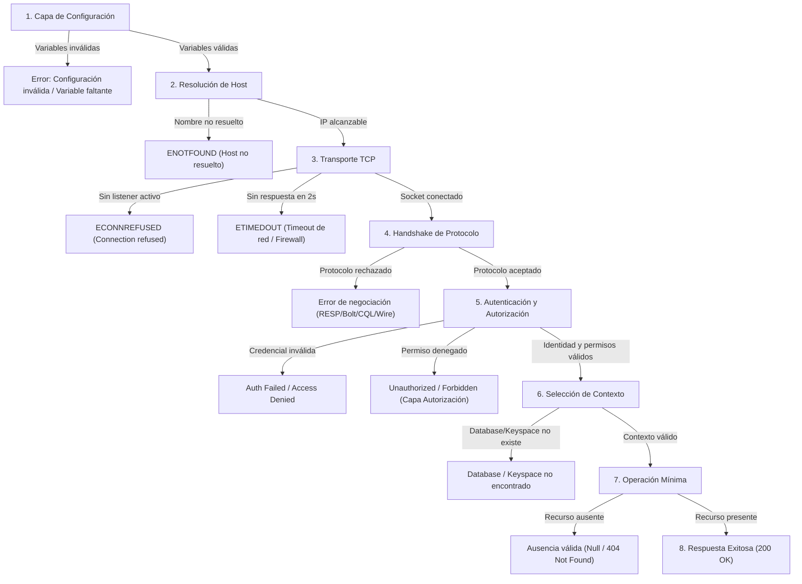

# Diagnóstico de Fallas y Simulación Controlada

**Asignatura:** Ingeniería de Datos II  
**Hito:** 11 — Evaluación de Conectividad a los Productos del Fixture 2030  
**Fecha:** Octubre 2026  

---

## 1. Clasificación de Fallas por Capa

Un objetivo medular del Hito 11 es evitar el diagnóstico superficial ("la base no anda") y atribuir cada anomalía a su capa exacta de origen:



---

## 2. Diferenciación Rigurosa de Anomalías

### A. Redis: Clave Inexistente vs. Servidor Caído
- **Clave inexistente:** El comando `GET fixture2030:test:nonexistent_probe_key` retorna `null` y `TTL` retorna `-2` en menos de 1ms (operación de solo lectura). La conexión está sana; simplemente el dato no fue cargado o expiró por TTL.
- **Redis caído:** El comando lanza una excepción de socket (`ECONNREFUSED 127.0.0.1:6379`) y la API Fastify responde con código HTTP **503 Service Unavailable** (`DEPENDENCY_UNAVAILABLE`).

### B. Neo4j: Partido Inexistente vs. Error de Conexión Bolt
- **Partido inexistente:** La consulta Cypher parametrizada `MATCH (p:Partido {id: $id}) RETURN p.id AS id, p.fase AS fase LIMIT 1` (con parámetro `{ id: 'F2030-999' }`) finaliza con éxito y devuelve 0 registros (`records.length === 0`). La API traduce esto a un HTTP **404 Not Found** (`RESOURCE_NOT_FOUND`).
- **Error de conexión Bolt:** El driver no logra realizar el handshake (`ServiceUnavailable: Failed to connect to bolt://127.0.0.1:7687`). La API no inventa una ausencia ni devuelve 404; devuelve HTTP **503 Service Unavailable** con código estructurado `DEPENDENCY_UNAVAILABLE` preservando el diagnóstico de infraestructura.

### C. InfluxDB 3: Intervalo sin Puntos vs. Base Inexistente vs. Token Inválido o Sin Permisos
- **Intervalo sin puntos:** El endpoint devuelve HTTP 200 con un arreglo vacío de mediciones `{ "teams": [] }`. El servicio funciona y la consulta es válida.
- **Token inválido (401) vs. Permisos insuficientes (403):** Un HTTP **401 Unauthorized** en `/api/v3/query_sql` indica fallo en la capa de **Autenticación** (token inválido o expirado), mientras que un HTTP **403 Forbidden** indica fallo en la capa de **Autorización** (token autenticado pero sin permisos sobre la base temporal).
- **InfluxDB inalcanzable:** La función `fetch` lanza `TypeError: fetch failed` por rechazo TCP en puerto 8181; la API responde HTTP **503**.

### D. InterSystems IRIS: Portal Web vs. SuperServer y Validación de `%SQLCODE`
- **Portal Web (52773):** Utiliza HTTP y permite administrar la instancia mediante navegador. Que el portal responda no garantiza que el SuperServer binario acepte conexiones de clientes nativos.
- **SuperServer (1972):** Utiliza el protocolo binario de IRIS (`@intersystems/intersystems-iris-native`). Además de autenticar en el namespace `USER`, la verificación de contexto valida el `%Status` de `%Prepare` y lee `%SQLCODE` mediante `rows.getNumber('%SQLCODE')` y `%Message` mediante `rows.getString('%Message')` tanto después de `%Execute` como después de `rows.invokeBoolean('%Next')`, separando estrictamente una ausencia controlada (`%SQLCODE` en `0` o `100` con `%Next = false`) de un error SQL (`%SQLCODE < 0`).

### E. MongoDB y Cassandra: Handshake Exitoso vs. Fallo Posterior de Autorización (`code: 13` / `0x2100`)
- En **MongoDB**, cuando el servidor acepta la conexión y responde `{ ok: 1 }` al comando `ping` en `authSource`, la capa de **Handshake** queda certificada como **UP**. Si posteriormente `listCollections` sobre `fixture2030` es rechazado con `MongoServerError: not authorized` (`code: 13`, `codeName: 'Unauthorized'`), el clasificador `classifyNativeError` registra la falla en la capa de **Autorización** (`DOWN`) y marca **Operación mínima** como `SKIP`, sin contradecir el `Handshake: UP`.
- En **Cassandra**, si el handshake CQL tiene éxito pero `client.metadata.getTable()` es rechazado por permisos (`code: 0x2100` / `UnauthorizedException`) o expira por timeout, la excepción se propaga al clasificador para reportar `Autorización: DOWN` (o `Contexto: DOWN` en caso de timeout), reservando el estado `Contexto: DEGRADED (tabla no creada)` exclusivamente para cuando la consulta de metadatos finaliza con éxito y devuelve `null`.

---

## 3. Escenario de Falla Controlada y Simulación Híbrida (RF20, RF21, 5.7, RNF17, RNF18)

### 3.1 Simulación Híbrida In-Process Ejecutada (`scripts/prueba_falla_controlada.ts`)

En cumplimiento de la sección §5.7 del enunciado (que habilita realizar una simulación controlada cuando no se cuenta con todos los contenedores activos en el host), se ejecutó el script reproducible `scripts/prueba_falla_controlada.ts`. El reporte íntegro autogenerado se encuentra en [`docs/evidencia/ciclo_falla_recuperacion.md`](./evidencia/ciclo_falla_recuperacion.md).

- **Naturaleza de la prueba:** **Simulación híbrida in-process** sobre instancia real de Fastify (`buildServer`) y `registerErrorHandler`.
- **Fecha/Hora de ejecución:** `2026-10-23T15:22:57.360Z`
- **Entorno:** `win32 (x64) — Node.js v25.9.0`
- **Commit base:** `e3f382c`
- **Comando ejecutado:**
  ```bash
  pnpm --dir hito-10-api exec tsx ../hito-11-conectividad/scripts/prueba_falla_controlada.ts --output=../hito-11-conectividad/docs/evidencia/ciclo_falla_recuperacion.md
  ```

#### Alcance y Límites Explícitos de la Simulación Híbrida
1. **Partes simuladas mediante dobles en memoria (Etapas 1 y 3):**
   - La autorización Bearer (`authModule`) y las respuestas `200 OK` de las **Etapas 1 y 3** son provistas por dobles en memoria que devuelven una entidad `ARG` estática y emiten un registro de log explícitamente rotulado con `"result": "simulated_double_success"` y `"source": "in-memory-double"`.
   - **Estas etapas no se conectan, no leen ni reconectan una instancia real de MongoDB.**
2. **Parte ejercida contra el adaptador y driver reales (Etapa 2):**
   - Únicamente en la **Etapa 2** se invoca una instancia real de `MongoDocumentRepository` (y el driver oficial `mongodb`) apuntando al puerto local sin listener `127.0.0.1:27099` (`DEPENDENCY_TIMEOUT_MS=500ms`), provocando un `MongoServerSelectionError` (`ECONNREFUSED`) real que es traducido por `DataService` y `registerErrorHandler` en una respuesta HTTP `503 Service Unavailable` (`DEPENDENCY_UNAVAILABLE`).
3. **Lo que esta prueba demuestra vs. lo que queda pendiente con contenedores activos:**
   - **Demuestra:** Que el servidor Fastify (`buildServer`) y su manejador de errores capturan el fallo de conexión real del adaptador documental dentro del timeout configurado (`~520ms`), responden `HTTP 503` con `code: "DEPENDENCY_UNAVAILABLE"` y `x-request-id` correlacionado en cuerpo y logs Pino, y mantienen vivo el proceso HTTP para peticiones subsiguientes.
   - **No demuestra (pendiente de ejecución contra motor MongoDB real):** Esta simulación **no comprueba la restauración real del servicio MongoDB, la lectura de documentos desde una base real ni la conservación de datos persistidos en volúmenes tras un reinicio**; dicha comprobación requiere ejecutar el procedimiento operativo de §3.2 sobre un entorno con el contenedor MongoDB activo.

#### Etapa 1 — Estado Inicial Simulado en API (Doble en memoria → HTTP 200 OK)
- **Mecanismo activo:** Doble en memoria (entidad `ARG` fija y sesión simulada; sin conexión a MongoDB).
- **Status HTTP:** `200 OK` (latencia: `218ms`).
- **Header `x-request-id`:** `f2aa6f94-9fd1-42b1-b5a7-1469c8e81522`.
- **Cuerpo HTTP recibido:**
  ```json
  {
    "id": "550e8400-e29b-41d4-a716-446655440001",
    "code": "ARG",
    "name": "Argentina",
    "confederation": "CONMEBOL",
    "selectionOrigin": "Anfitrión conmemorativo",
    "qualificationStage": "Clasificado directo",
    "participates": true,
    "trainingBase": "Predio Lionel Andrés Messi (Ezeiza)"
  }
  ```
- **Logs estructurados Pino capturados:**
  ```json
  {"level":30,"time":1792768976834,"pid":2592,"hostname":"DESKTOP-ABP7874","reqId":"f2aa6f94-9fd1-42b1-b5a7-1469c8e81522","dependency":"MongoDB","operation":"findTeam","result":"simulated_double_success","source":"in-memory-double","durationMs":0.009299999997892883,"msg":"Operación simulada en doble de prueba (sin conexión a MongoDB)"}
  {"level":30,"time":1792768976837,"pid":2592,"hostname":"DESKTOP-ABP7874","reqId":"f2aa6f94-9fd1-42b1-b5a7-1469c8e81522","method":"GET","route":"/equipos/:codigo","statusCode":200,"durationMs":5.269099999997707,"msg":"Solicitud finalizada"}
  ```

#### Etapa 2 — Falla de Conexión Real en Adaptador (`MongoDocumentRepository` contra `127.0.0.1:27099` → HTTP 503)
- **Mecanismo activo:** Adaptador real `MongoDocumentRepository` + driver `mongodb` contra `127.0.0.1:27099` sin listener (`DEPENDENCY_TIMEOUT_MS=500ms`).
- **Status HTTP:** `503 Service Unavailable` (latencia acotada: `520ms`).
- **Header `x-request-id`:** `75e22946-bebf-40c2-98ff-302b39a83b7e`.
- **Cuerpo HTTP recibido:**
  ```json
  {
    "code": "DEPENDENCY_UNAVAILABLE",
    "message": "Una dependencia no está disponible.",
    "requestId": "75e22946-bebf-40c2-98ff-302b39a83b7e"
  }
  ```
- **Logs estructurados Pino capturados:**
  ```json
  {"level":30,"time":1792768977357,"pid":2592,"hostname":"DESKTOP-ABP7874","reqId":"75e22946-bebf-40c2-98ff-302b39a83b7e","dependency":"MongoDB","operation":"findTeam","result":"failure","durationMs":519.1098999999995,"msg":"Operación de dependencia"}
  {"level":50,"time":1792768977358,"pid":2592,"hostname":"DESKTOP-ABP7874","reqId":"75e22946-bebf-40c2-98ff-302b39a83b7e","code":"DEPENDENCY_UNAVAILABLE","statusCode":503,"msg":"Solicitud rechazada"}
  {"level":30,"time":1792768977358,"pid":2592,"hostname":"DESKTOP-ABP7874","reqId":"75e22946-bebf-40c2-98ff-302b39a83b7e","method":"GET","route":"/equipos/:codigo","statusCode":503,"durationMs":520.2936000000009,"msg":"Solicitud finalizada"}
  ```

#### Etapa 3 — Retorno Simulado en API al Conmutar Doble (Doble en memoria → HTTP 200 OK)
- **Mecanismo activo:** Conmutación al doble en memoria sin reiniciar Fastify (no reconecta ni lee MongoDB real).
- **Status HTTP:** `200 OK` (latencia: `1ms`).
- **Header `x-request-id`:** `cfb049c4-8aa7-4092-b837-ec5fb552a8a3`.
- **Logs estructurados Pino capturados:**
  ```json
  {"level":30,"time":1792768977359,"pid":2592,"hostname":"DESKTOP-ABP7874","reqId":"cfb049c4-8aa7-4092-b837-ec5fb552a8a3","dependency":"MongoDB","operation":"findTeam","result":"simulated_double_success","source":"in-memory-double","durationMs":0.004400000001623994,"msg":"Operación simulada en doble de prueba (sin conexión a MongoDB)"}
  {"level":30,"time":1792768977359,"pid":2592,"hostname":"DESKTOP-ABP7874","reqId":"cfb049c4-8aa7-4092-b837-ec5fb552a8a3","method":"GET","route":"/equipos/:codigo","statusCode":200,"durationMs":0.29209999999875436,"msg":"Solicitud finalizada"}
  ```

---

### 3.2 Procedimiento Operativo de Referencia con Docker Compose (Guía Operativa No Ejecutada en este Host)

*(Nota: Los siguientes pasos constituyen el procedimiento operativo de referencia para verificar en vivo la detención, restauración y conservación de volúmenes de MongoDB en un entorno con el stack Docker Compose activo; esta verificación end-to-end contra contenedores reales no fue ejecutada en este host).*

1. **Verificación inicial con stack activo:**
   ```bash
   pnpm --dir hito-10-api eval:conectividad -- --product=mongodb
   ```
2. **Detención temporal no destructiva del contenedor (conservando volúmenes):**
   ```bash
   docker compose stop mongodb
   ```
3. **Verificación de degradación controlada (`503 DEPENDENCY_UNAVAILABLE`):**
   ```bash
   pnpm --dir hito-10-api eval:conectividad -- --product=mongodb
   ```
4. **Restauración del contenedor y verificación posterior de lectura persistida:**
   ```bash
   docker compose start mongodb
   pnpm --dir hito-10-api eval:conectividad -- --product=mongodb
   ```
