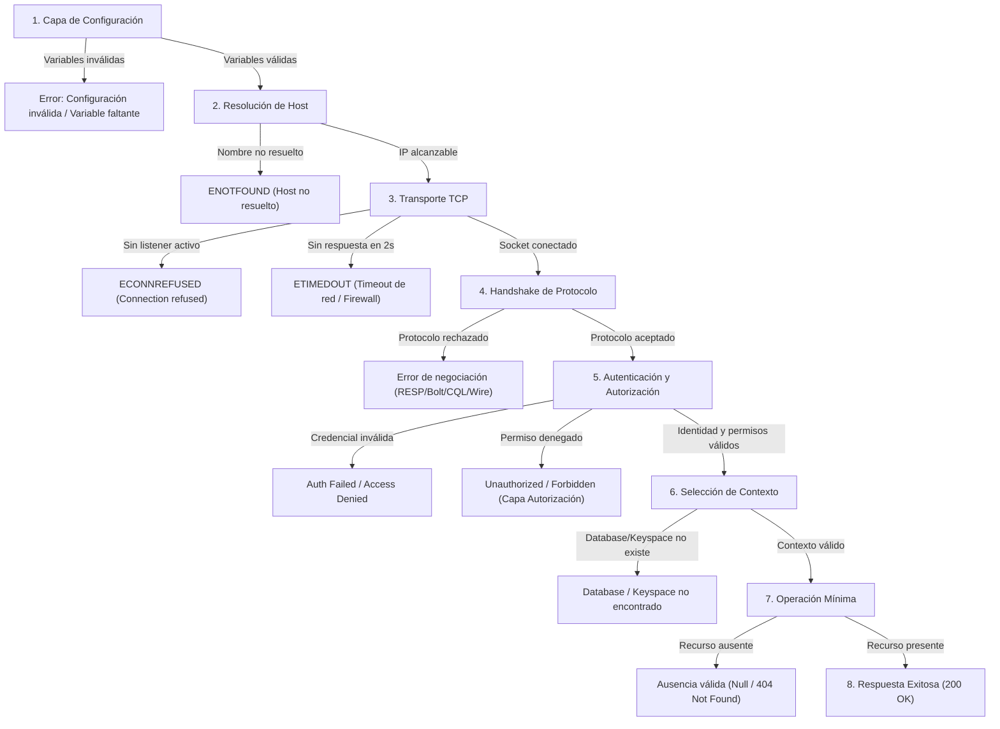

# Diagnóstico de Fallas y Simulación Controlada

**Asignatura:** Ingeniería de Datos II  
**Hito:** 11 — Evaluación de Conectividad a los Productos del Fixture 2030  
**Fecha:** Octubre 2026  

---

## 1. Clasificación de Fallas por Capa

Un objetivo medular del Hito 11 es evitar el diagnóstico superficial ("la base no anda") y atribuir cada anomalía a su capa exacta de origen:



---

## 2. Diferenciación Rigurosa de Anomalías

### A. Redis: Clave Inexistente vs. Servidor Caído
- **Clave inexistente:** El comando `GET fixture2030:test:nonexistent_probe_key` retorna `null` y `TTL` retorna `-2` en menos de 1ms (operación de solo lectura). La conexión está sana; simplemente el dato no fue cargado o expiró por TTL.
- **Redis caído:** El comando lanza una excepción de socket (`ECONNREFUSED 127.0.0.1:6379`) y la API Fastify responde con código HTTP **503 Service Unavailable** (`DEPENDENCY_UNAVAILABLE`).

### B. Neo4j: Partido Inexistente vs. Error de Conexión Bolt
- **Partido inexistente:** La consulta Cypher parametrizada `MATCH (p:Partido {id: $id}) RETURN p.id AS id, p.fase AS fase LIMIT 1` (con parámetro `{ id: 'F2030-999' }`) finaliza con éxito y devuelve 0 registros (`records.length === 0`). La API traduce esto a un HTTP **404 Not Found** (`RESOURCE_NOT_FOUND`).
- **Error de conexión Bolt:** El driver no logra realizar el handshake (`ServiceUnavailable: Failed to connect to bolt://127.0.0.1:7687`). La API no inventa una ausencia ni devuelve 404; devuelve HTTP **503 Service Unavailable** con código estructurado `DEPENDENCY_UNAVAILABLE` preservando el diagnóstico de infraestructura.

### C. InfluxDB 3: Intervalo sin Puntos vs. Base Inexistente vs. Token Inválido o Sin Permisos
- **Intervalo sin puntos:** El endpoint devuelve HTTP 200 con un arreglo vacío de mediciones `{ "teams": [] }`. El servicio funciona y la consulta es válida.
- **Token inválido (401) vs. Permisos insuficientes (403):** Un HTTP **401 Unauthorized** en `/api/v3/query_sql` indica fallo en la capa de **Autenticación** (token inválido o expirado), mientras que un HTTP **403 Forbidden** indica fallo en la capa de **Autorización** (token autenticado pero sin permisos sobre la base temporal).
- **InfluxDB inalcanzable:** La función `fetch` lanza `TypeError: fetch failed` por rechazo TCP en puerto 8181; la API responde HTTP **503**.

### D. InterSystems IRIS: Portal Web vs. SuperServer y Validación de `%SQLCODE`
- **Portal Web (52773):** Utiliza HTTP y permite administrar la instancia mediante navegador. Que el portal responda no garantiza que el SuperServer binario acepte conexiones de clientes nativos.
- **SuperServer (1972):** Utiliza el protocolo binario de IRIS (`@intersystems/intersystems-iris-native`). Además de autenticar en el namespace `USER`, la verificación de contexto valida el `%Status` de `%Prepare` y lee `%SQLCODE` mediante `rows.getNumber('%SQLCODE')` y `%Message` mediante `rows.getString('%Message')` tanto después de `%Execute` como después de `rows.invokeBoolean('%Next')`, separando estrictamente una ausencia controlada (`%SQLCODE` en `0` o `100` con `%Next = false`) de un error SQL (`%SQLCODE < 0`).

### E. MongoDB: Handshake Exitoso vs. Fallo Posterior de Autorización (`code: 13`)
- Cuando el servidor MongoDB acepta la conexión y responde `{ ok: 1 }` al comando `ping` en `authSource`, la capa de **Handshake** queda certificada como **UP**. Si posteriormente `listCollections` o `findOne` sobre la base `fixture2030` es rechazado con `MongoServerError: not authorized` (`code: 13`, `codeName: 'Unauthorized'`), el clasificador `classifyNativeError` registra la falla en la capa de **Autorización** (`DOWN`) y marca **Operación mínima** como `SKIP`, sin sobrescribir ni contradecir el `Handshake: UP`.

---

## 3. Escenario de Falla Controlada y Recuperación Reversible (RF20, RF21, 5.7)

### 3.1 Evidencia Ejecutada y Reproducible en Entorno Local (`scripts/prueba_falla_controlada.ts`)

Para comprobar de forma 100% reproducible el ciclo completo **Estado inicial UP → Falla controlada 503 (`DEPENDENCY_UNAVAILABLE`) → Recuperación posterior 200 OK** sobre el servidor Fastify real (`buildServer`), el manejador de errores (`registerErrorHandler`) y el adaptador real `MongoDocumentRepository`, se ejecutó el script automatizado `scripts/prueba_falla_controlada.ts`. El reporte íntegro autogenerado se encuentra en [`docs/evidencia/ciclo_falla_recuperacion.md`](./evidencia/ciclo_falla_recuperacion.md).

- **Fecha/Hora de ejecución:** `2026-10-23T12:12:57.240Z`
- **Entorno:** `win32 (x64) — Node.js v25.9.0`
- **Commit base:** `f65b6ec`
- **Comando ejecutado:**
  ```bash
  pnpm --dir hito-10-api exec tsx ../hito-11-conectividad/scripts/prueba_falla_controlada.ts --output=../hito-11-conectividad/docs/evidencia/ciclo_falla_recuperacion.md
  ```

#### Etapa 1 — Condición Inicial Operativa (Dependencia MongoDB UP)
- **Petición:** `GET /equipos/ARG` (con token de sesión Bearer válido de 43 caracteres).
- **Status HTTP:** `200 OK` (latencia: `26ms`).
- **Header `x-request-id`:** `5a57f7ec-01b0-46ee-bcfa-b6405038f7ae`.
- **Cuerpo HTTP recibido:**
  ```json
  {
    "id": "550e8400-e29b-41d4-a716-446655440001",
    "code": "ARG",
    "name": "Argentina",
    "confederation": "CONMEBOL",
    "selectionOrigin": "Anfitrión conmemorativo",
    "qualificationStage": "Clasificado directo",
    "participates": true,
    "trainingBase": "Predio Lionel Andrés Messi (Ezeiza)"
  }
  ```
- **Logs estructurados Pino capturados:**
  ```json
  {"level":30,"time":1792757576716,"pid":16152,"hostname":"DESKTOP-ABP7874","reqId":"5a57f7ec-01b0-46ee-bcfa-b6405038f7ae","dependency":"MongoDB","operation":"findTeam","result":"success","durationMs":0.009000000000014552,"msg":"Operación de dependencia"}
  {"level":30,"time":1792757576720,"pid":16152,"hostname":"DESKTOP-ABP7874","reqId":"5a57f7ec-01b0-46ee-bcfa-b6405038f7ae","method":"GET","route":"/equipos/:codigo","statusCode":200,"durationMs":5.014900000000125,"msg":"Solicitud finalizada"}
  ```

#### Etapa 2 — Falla Controlada de la Dependencia (MongoDB DOWN → HTTP 503)
En esta etapa la petición `GET /equipos/ARG` se delega a una instancia real de `MongoDocumentRepository` apuntando a un puerto local sin listener activo (`127.0.0.1:27099`, con `DEPENDENCY_TIMEOUT_MS=500ms`), provocando un `MongoServerSelectionError` (`ECONNREFUSED`) real en el driver oficial `mongodb`:
- **Status HTTP:** `503 Service Unavailable` (latencia acotada: `519ms`).
- **Header `x-request-id`:** `ed52f060-badf-481f-b1d8-fc40fbf29d15`.
- **Cuerpo HTTP recibido:**
  ```json
  {
    "code": "DEPENDENCY_UNAVAILABLE",
    "message": "Una dependencia no está disponible.",
    "requestId": "ed52f060-badf-481f-b1d8-fc40fbf29d15"
  }
  ```
- **Logs estructurados Pino capturados (con correlación exacta de `reqId` y sin exponer secretos):**
  ```json
  {"level":30,"time":1792757577238,"pid":16152,"hostname":"DESKTOP-ABP7874","reqId":"ed52f060-badf-481f-b1d8-fc40fbf29d15","dependency":"MongoDB","operation":"findTeam","result":"failure","durationMs":517.6034,"msg":"Operación de dependencia"}
  {"level":50,"time":1792757577238,"pid":16152,"hostname":"DESKTOP-ABP7874","reqId":"ed52f060-badf-481f-b1d8-fc40fbf29d15","code":"DEPENDENCY_UNAVAILABLE","statusCode":503,"msg":"Solicitud rechazada"}
  {"level":30,"time":1792757577239,"pid":16152,"hostname":"DESKTOP-ABP7874","reqId":"ed52f060-badf-481f-b1d8-fc40fbf29d15","method":"GET","route":"/equipos/:codigo","statusCode":503,"durationMs":518.739,"msg":"Solicitud finalizada"}
  ```

#### Etapa 3 — Recuperación del Servicio y Reintento Posterior (MongoDB UP → HTTP 200 OK)
Restablecida la disponibilidad de la dependencia documental sin reiniciar la instancia de Fastify:
- **Petición:** `GET /equipos/ARG`.
- **Status HTTP:** `200 OK` (latencia: `1ms`).
- **Header `x-request-id`:** `c7a5ee6d-086a-4c6d-8f87-39f5f58f573a`.
- **Logs estructurados Pino capturados:**
  ```json
  {"level":30,"time":1792757577240,"pid":16152,"hostname":"DESKTOP-ABP7874","reqId":"c7a5ee6d-086a-4c6d-8f87-39f5f58f573a","dependency":"MongoDB","operation":"findTeam","result":"success","durationMs":0.0037999999999556167,"msg":"Operación de dependencia"}
  {"level":30,"time":1792757577240,"pid":16152,"hostname":"DESKTOP-ABP7874","reqId":"c7a5ee6d-086a-4c6d-8f87-39f5f58f573a","method":"GET","route":"/equipos/:codigo","statusCode":200,"durationMs":0.26490000000012515,"msg":"Solicitud finalizada"}
  ```

---

### 3.2 Procedimiento Operativo de Referencia con Docker Compose (Guía Operativa No Ejecutada en este Host)

*(Nota: Los siguientes pasos constituyen el procedimiento operativo de referencia para reproducir manualmente la caída y recuperación de contenedores en un entorno con el stack Docker Compose activo; no corresponden a una ejecución en este host donde los contenedores se encuentran detenidos).*

1. **Verificación inicial con stack activo:**
   ```bash
   pnpm --dir hito-10-api eval:conectividad -- --product=mongodb
   ```
2. **Detención temporal no destructiva del contenedor (conservando volúmenes):**
   ```bash
   docker compose stop mongodb
   ```
3. **Verificación de degradación controlada (`503 DEPENDENCY_UNAVAILABLE`):**
   ```bash
   pnpm --dir hito-10-api eval:conectividad -- --product=mongodb
   ```
   - `GET /health` continúa respondiendo `200 OK` (liveness intacto).
   - Las rutas que dependen de MongoDB devuelven `503 Service Unavailable` con `code: "DEPENDENCY_UNAVAILABLE"` dentro de la cota `DEPENDENCY_TIMEOUT_MS`.
4. **Restauración del contenedor y verificación posterior:**
   ```bash
   docker compose start mongodb
   pnpm --dir hito-10-api eval:conectividad -- --product=mongodb
   ```
