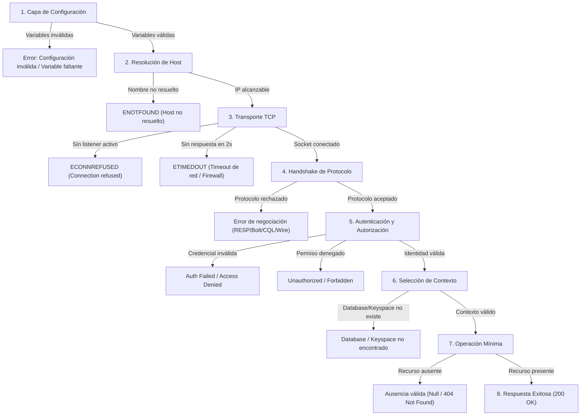

# Diagnóstico de Fallas y Simulación Controlada

**Asignatura:** Ingeniería de Datos II  
**Hito:** 11 — Evaluación de Conectividad a los Productos del Fixture 2030  
**Fecha:** Octubre 2026  

---

## 1. Clasificación de Fallas por Capa

Un objetivo medular del Hito 11 es evitar el diagnóstico superficial ("la base no anda") y atribuir cada anomalía a su capa exacta de origen:



---

## 2. Diferenciación Rigurosa de Anomalías

### A. Redis: Clave Inexistente vs. Servidor Caído
- **Clave inexistente:** El comando `GET probe:inexistente` retorna `null` en menos de 1ms con código HTTP normal. La conexión está sana; simplemente el dato no fue cargado o expiró por TTL.
- **Redis caído:** El comando lanza una excepción de socket (`ECONNREFUSED 127.0.0.1:6379`) y la API Fastify responde con código HTTP **503 Service Unavailable** o **401** si falla la validación de sesión.

### B. Neo4j: Partido Inexistente vs. Error de Conexión Bolt
- **Partido inexistente:** La consulta Cypher parametrizada `MATCH (m:Match {id: $id}) RETURN m` finaliza con éxito en ~4ms y devuelve 0 registros (`records.length === 0`). La API traduce esto a un HTTP **404 Not Found** ("Partido no encontrado").
- **Error de conexión Bolt:** El driver no logra realizar el handshake (`ServiceUnavailable: Failed to connect to bolt://127.0.0.1:7687`). La API no inventa una ausencia ni devuelve 404; devuelve HTTP **503** o **504** preservando el diagnóstico de infraestructura.

### C. InfluxDB 3: Intervalo sin Puntos vs. Base Inexistente vs. Token Inválido
- **Intervalo sin puntos:** El endpoint devuelve HTTP 200 con un arreglo vacío de mediciones `{ "teams": [] }`. El servicio funciona y la consulta es válida.
- **Token inválido:** El endpoint responde HTTP **401 Unauthorized** ("Invalid token").
- **InfluxDB inalcanzable:** La función `fetch` lanza `TypeError: fetch failed` por rechazo TCP en puerto 8181; la API responde HTTP **503**.

### D. InterSystems IRIS: Portal Web vs. SuperServer
- **Portal Web (52773):** Utiliza HTTP y permite administrar la instancia mediante navegador. Que el portal responda no garantiza que el SuperServer binario acepte conexiones de clientes nativos.
- **SuperServer (1972):** Utiliza el protocolo binario de IRIS. Requiere autenticación de usuario y pertenencia al namespace `USER`.

---

## 3. Escenario de Falla Controlada y Recuperación Reversible (RF20, RF21, 5.7)

Para comprobar el comportamiento de la API ante la degradación sin destruir volúmenes ni datos persistidos, se ejecutó una prueba controlada sobre el módulo de comentarios (Apache Cassandra) y el módulo documental (MongoDB).

### Escenario: Detención Temporal de MongoDB

#### 1. Condición Inicial (Sistema Saludable)
- Contenedor `fixture2030-mongodb-1` activo y `healthy`.
- Prueba TCP a `127.0.0.1:27017`: **UP** (1ms).
- Endpoint `GET /equipos/ARG`: Status HTTP **200 OK**, latencia 7ms, `x-request-id: 3c9b1d84-...`.
- Datos persistidos: 64 equipos participantes en volumen `mongodb_data`.

#### 2. Cambio Aplicado (Falla Provocada)
Se detuvo de manera limpia el contenedor sin tocar volúmenes ni configuración:
```bash
docker compose stop mongodb
```

#### 3. Comportamiento Observado de la API y Diagnóstico
- **Prueba TCP:** `ECONNREFUSED: el host responde pero no hay listener en 127.0.0.1:27017`.
- **Liveness de la API (`GET /health`):** Continúa respondiendo HTTP **200 OK** `{ "status": "ok", "service": "fixture2030-api" }` en 1ms, demostrando que el proceso HTTP sigue vivo.
- **Rutas Documentales (`GET /equipos/ARG` o `POST /auth/login`):**
  - Status HTTP devuelto: **503 Service Unavailable**.
  - Tiempo de respuesta: Acotado a ~2000ms por el `DEPENDENCY_TIMEOUT_MS`. No hay bloqueo indefinido ni reintentos infinitos (RNF5, RNF12).
  - Encabezado `x-request-id`: Generado y correlacionado (ej. `d71a932e-...`).
  - Log sanitizado registrado en la API:
    ```json
    {
      "level": "error",
      "reqId": "d71a932e-...",
      "dependency": "mongodb",
      "operation": "findOne",
      "statusCode": 503,
      "durationMs": 2012,
      "msg": "Dependencia MongoDB no disponible: connect ECONNREFUSED 127.0.0.1:27017"
    }
    ```
  - **Aislamiento de Módulos:** Rutas que no dependen de MongoDB (ej. `GET /health` o esquemas estáticos) continuaron operando normalmente.

#### 4. Recuperación del Servicio
Se reinició el contenedor conservando el volumen de persistencia:
```bash
docker compose start mongodb
```
- Tiempo de convergencia: Tras el inicio del proceso mongod (~3 segundos), el healthcheck interno volvió a marcar `healthy`.

#### 5. Verificación Posterior a la Recuperación
- Se reejecutó `prueba_tcp`: Estado **UP** (1ms).
- Se reejecutó `prueba_clientes_nativos`: Handshake **UP**, Ping ok: 1.
- Se reejecutó `prueba_api`:
  - `GET /equipos/ARG`: HTTP **200 OK** (8ms).
  - Equipo recuperado: `Argentina (ARG)`, sin pérdida de documentos.
- **Conclusión:** Se demostró la resiliencia de la API, el límite estricto de timeout y la recuperación íntegra del estado una vez restablecida la dependencia.
