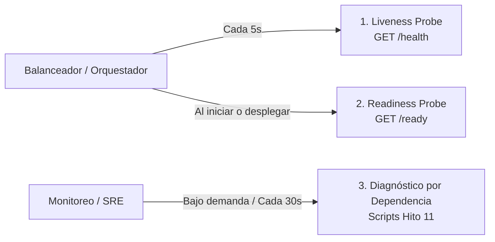

# Estrategia de Health, Readiness y Diagnóstico

**Asignatura:** Ingeniería de Datos II  
**Hito:** 11 — Evaluación de Conectividad a los Productos del Fixture 2030  
**Fecha:** Octubre 2026  

---

## 1. Separación de Responsabilidades: Liveness vs. Readiness

En arquitecturas políglotas con múltiples motores NoSQL, una política inadecuada de health check puede provocar caídas en cascada o falsos positivos. Se definen tres niveles de evaluación claramente diferenciados:



### A. Liveness Probe (`GET /health`) — *Implementado en Hito 10*
- **Propósito:** Responder si el proceso Node.js / Fastify está vivo y el event loop puede despachar solicitudes HTTP.
- **Estado de implementación:** Actualmente implementado en `hito-10-api` (`src/app/routes/health.route.ts`).
- **Comportamiento:** No realiza consultas a ninguna base de datos ni a la red externa. Retorna un objeto estático:
  ```json
  {
    "status": "ok",
    "service": "fixture2030-api"
  }
  ```
- **Costo computacional:** Virtualmente nulo (< 1ms).
- **Frecuencia admisible:** Alta (cada 5 a 10 segundos).
- **Entorno de ejecución:** La API se ejecuta en el entorno host de desarrollo (`pnpm dev` / `node dist/index.js`), sin un orquestador Kubernetes o reinicio automático en contenedor. En un despliegue contenerizado propuesto, un liveness probe fallido gatillaría el reinicio del proceso.

### B. Readiness Probe (`GET /ready`) — *Propuesta Arquitectónica / Futura Extensión*
- **Propósito:** Indicar si la API está en condiciones de recibir y despachar tráfico real de usuarios hacia los motores NoSQL.
- **Estado de implementación:** **Propuesta de diseño arquitectónico** (no implementada en el código base actual de Hito 10 para no sobrecargar el core antes de validar conectividad elemental).
- **Diseño propuesto:** Comprueba las dependencias críticas mínimas de infraestructura requeridas para el arranque (por ejemplo, que Redis o MongoDB respondan al handshake inicial con timeouts acotados).
- **Criterio de degradación:** Si una dependencia secundaria (ej. Cassandra o InfluxDB) no responde, la API puede declararse en estado `DEGRADED`, sirviendo tráfico para los módulos sanos mientras se aísla el módulo afectado.

### C. Diagnóstico Profundo por Dependencia (Deep Check / Suite Hito 11)
- **Propósito:** Proporcionar visibilidad detallada y granular del estado de cada motor (MongoDB, Redis, Neo4j, Cassandra, InfluxDB, IRIS) en las capas de Transporte, Protocolo y Contexto.
- **Herramienta:** Implementado en la suite de scripts reproducibles (`scripts/evaluar_conectividad.ts`).
- **Estados reportados:** `UP`, `DOWN`, `DEGRADED`, `NOT_CONFIGURED`, `SKIP`, `UNKNOWN`.

---

## 2. Justificación Técnica: Por qué NO consultar todas las bases en cada request

El enunciado del Hito 11 establece explícitamente:
> *"No se deberá consultar indiscriminadamente todas las bases en cada request normal. Si se implementa un chequeo profundo, se deberá documentar su frecuencia, timeout y costo."*

### Razones Técnicas Fundamentales:
1. **Evitar la Amplificación de Tráfico y Latencia:** Si cada consulta a `GET /equipos/ARG` disparase un ping a Cassandra, Neo4j, InfluxDB y Redis, la latencia de respuesta se degradaría al peor caso de la suma de todas las bases.
2. **Eliminación del Punto Único de Falla Artificial:** Consultar todas las bases en cada petición provocaría que una falla en InfluxDB bloquee o tire abajo una consulta puramente documental de MongoDB.
3. **Saturación del Pool de Conexiones:** Los handshakes y pings concurrentes consumirían conexiones en sockets y descriptores de archivo innecesariamente.
4. **Protección del Event Loop:** Fastify utiliza un modelo asíncrono no bloqueante. Esperar timeouts múltiples en un solo request bloquea recursos del servidor.

---

## 3. Especificación de Parámetros Operativos

| Parámetro | Valor Configurado | Justificación y Semántica Técnica |
|:---|:---:|:---|
| **Timeout por Dependencia (`DEPENDENCY_TIMEOUT_MS`)** | `2000ms` (2 segundos) | Límite individual de operación para los adaptadores de base de datos (MongoDB, Redis, Neo4j, Cassandra, InfluxDB, IRIS). Falla rápido ante caídas de red para liberar el socket HTTP. |
| **Fastify Request Timeout (`API_REQUEST_TIMEOUT_MS`)** | `10000ms` (10 segundos) | Límite de Fastify a nivel de socket (`requestTimeout`) para la recepción de los bytes de la solicitud entrante. **No es un deadline de consulta a las bases de datos**, sino una protección de transporte contra clientes lentos (*slowloris*). |
| **Frecuencia de Diagnóstico Periódico (Propuesta)** | Cada `30` a `60` segundos | Intervalo óptimo estimado para telemetría sin generar sobrecarga sobre los motores. |
| **Política de Reintentos (Propuesta)** | Máximo 1 reintento con backoff lineal | Impide el efecto "thundering herd" contra una base que se está recuperando. |
| **Contrato Real de Errores ante Falla de Dependencias** | HTTP 503 (`DEPENDENCY_UNAVAILABLE` o `REQUEST_TIMEOUT`) | Implementado en `hito-10-api` (`src/app/errors/api-error.ts` y `error-handler.ts`). Cuando un adaptador no puede comunicarse con su motor o agota `DEPENDENCY_TIMEOUT_MS`, la API responde con status HTTP 503 y payload: <br>`{ "code": "DEPENDENCY_UNAVAILABLE", "message": "Una dependencia no está disponible.", "requestId": "..." }`<br>o `{ "code": "REQUEST_TIMEOUT", "message": "La operación superó el tiempo de espera.", "requestId": "..." }`. *(Nota: `DEPENDENCY_FAILED` es una etiqueta de clasificación interna de la herramienta de evaluación, no un código retornado por el servidor API).* |
