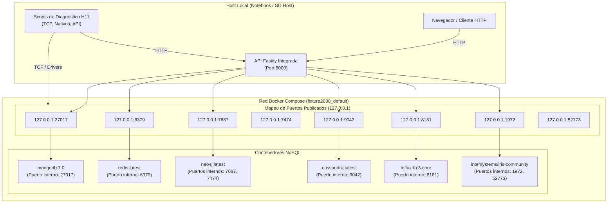

# Topología de Red y Entornos de Ejecución

**Asignatura:** Ingeniería de Datos II  
**Hito:** 11 — Evaluación de Conectividad a los Productos del Fixture 2030  
**Fecha:** Octubre 2026  

---

## 1. Topología de Conexión

La arquitectura del Fixture 2030 distingue dos entornos principales de ejecución:
1. **Entorno de Host Local (Notebook / Máquina de Desarrollo):** Donde se ejecutan los scripts de diagnóstico, la API en modo de desarrollo (`pnpm dev`) y las suites de pruebas automatizadas.
2. **Entorno Contenerizado (Docker Compose):** Donde residen los motores de base de datos como servicios independientes, comunicados a través de una red puente (`bridge`) aislada.

---

## 2. Diferencias Críticas de Entorno: Host vs. Contenedor

Una de las consideraciones esenciales del Hito 11 (RNF3) es no asumir que `localhost` significa lo mismo en todos los contextos:

### A. Ejecución desde el Host (Notebook)
- **Host de destino:** `127.0.0.1` o `localhost`.
- **Resolución:** El sistema operativo resuelve `127.0.0.1` a la interfaz de loopback local.
- **Acceso:** Se accede a través de los **puertos publicados** en `compose.yaml` (ej. `127.0.0.1:27017:27017`).
- **Nombres de contenedor:** Intentar resolver el nombre de un contenedor (ej. `mongodb` o `cassandra`) directamente desde la notebook fallará con `ENOTFOUND`, a menos que se hayan editado archivos `hosts` o se use una red compartida.

### B. Ejecución dentro de la red Docker Compose
- **Host de destino:** Nombre del servicio Docker (`mongodb`, `redis`, `neo4j`, `cassandra`, `influxdb`, `iris`).
- **Resolución:** El DNS interno embebido de Docker resuelve automáticamente los nombres de servicio a las direcciones IP dinámicas de la subred `bridge`.
- **Acceso:** Se comunica directamente con los **puertos internos** del contenedor, sin necesidad de que dichos puertos estén mapeados al host exterior.
- **`localhost` dentro de un contenedor:** Hace referencia únicamente al propio espacio de red aislado de ese contenedor específico, no a la máquina anfitriona ni a los otros contenedores.

---

## 3. Matriz de Puertos: Publicados vs. Internos

| Servicio | Nombre en Compose | Puerto Interno (Docker) | Puerto Publicado (Host) | Binding de Seguridad | Protocolo de Transporte |
|:---|:---|:---:|:---:|:---:|:---|
| **MongoDB** | `mongodb` | `27017` | `27017` | `127.0.0.1:${MONGO_PORT:-27017}` | TCP / Mongo Wire |
| **Redis** | `redis` | `6379` | `6379` | `127.0.0.1:${REDIS_PORT:-6379}` | TCP / RESP |
| **Neo4j Bolt** | `neo4j` | `7687` | `7687` | `127.0.0.1:${NEO4J_BOLT_PORT:-7687}` | TCP / Bolt |
| **Neo4j HTTP** | `neo4j` | `7474` | `7474` | `127.0.0.1:${NEO4J_HTTP_PORT:-7474}` | TCP / HTTP |
| **Cassandra** | `cassandra` | `9042` | `9042` | `127.0.0.1:${CASSANDRA_PORT:-9042}` | TCP / CQL |
| **InfluxDB 3** | `influxdb` | `8181` | `8181` | `127.0.0.1:8181` | TCP / HTTP |
| **IRIS SuperServer** | `iris` | `1972` | `1972` | `127.0.0.1:${IRIS_SUPERSERVER_PORT:-1972}` | TCP / SuperServer |
| **IRIS Web Portal** | `iris` | `52773` | `52773` | `127.0.0.1:${IRIS_WEB_PORT:-52773}` | TCP / HTTP |
| **API Fastify** | N/A (Host) | N/A | `8000` | `127.0.0.1:${API_PORT:-8000}` | TCP / HTTP REST |

> **Nota de Seguridad de Red:** Todos los puertos publicados se vinculan explícitamente a `127.0.0.1` (loopback) para evitar exponer los motores NoSQL a la red local o interfaces públicas sin autenticación o con credenciales por defecto.

---

## 4. Tipos de Falla de Red y su Diagnóstico

| Tipo de Error | Síntoma Técnico | Causa Raíz Probable | Nivel de Diagnóstico |
|:---|:---|:---|:---|
| `ENOTFOUND` | Host no resuelto | Se utilizó el nombre de servicio Docker (ej. `mongodb`) desde el host exterior sin resolución DNS. | Capa de Resolución de Nombres |
| `ECONNREFUSED` | Connection Refused | El host responde pero no hay ningún proceso escuchando en el puerto, o el contenedor Docker está detenido. | Capa de Transporte TCP |
| `ETIMEDOUT` | Timeout de socket | El paquete no llega o no hay respuesta dentro de los 2000ms. Problema de firewall, subred inalcanzable o proceso saturado. | Capa de Red / Firewall |
| `EADDRINUSE` | Puerto en uso | Otro proceso (ej. un servicio del sistema o una instancia previa) ocupa el puerto local. | Capa de Listener Local |
