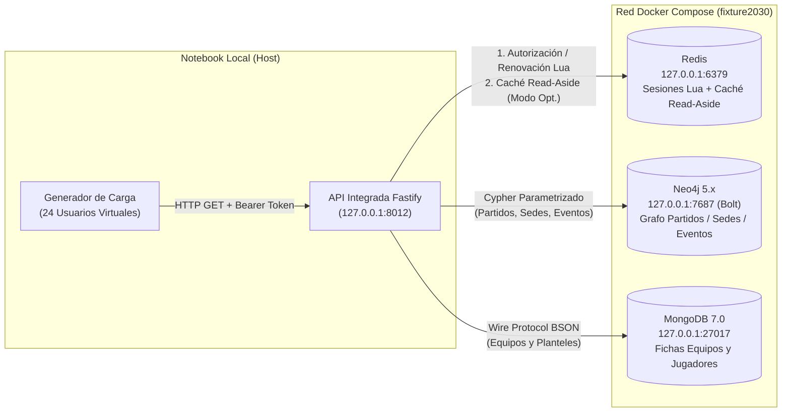

# Instrucciones del Entorno y Topología de Contenedores — Hito 12

Este documento describe la infraestructura de contenedores Docker, versiones observadas, límites de recursos y pasos de inicialización para reproducir las pruebas de carga y optimización del **Hito 12** sobre la plataforma **Fixture Mundial 2030** (RF4, RNF1, RNF7, RNF8, RNF9).

---

## 1. Topología de Servicios Involucrados en el Escenario

El flujo integrado sometido a carga involucra la **API Fastify (Node.js / TypeScript)** y tres motores NoSQL ejecutándose en contenedores Docker definidos en el [`compose.yaml`](../compose.yaml) de la raíz del repositorio:



| Servicio | Imagen en `compose.yaml` | Puerto Local Publicado | Rol en el Flujo Bajo Prueba | Configuración Relevante |
|:---|:---|:---:|:---|:---|
| **MongoDB** | `mongo:7.0` | `127.0.0.1:27017` | Fuente de verdad documental (`equipos`, `jugadores`, `usuarios_api`) | Validadores `$jsonSchema` estrictos; índices `equipos_codigo_unico`, `jugadores_equipo_dorsal_unico` y `jugadores_equipo_posicion_dorsal`. |
| **Neo4j** | `neo4j:latest` (`5.26.21`) | `127.0.0.1:7687` (Bolt)<br>`127.0.0.1:7474` (HTTP) | Grafo deportivo (`:Equipo`, `:Jugador`, `:Partido`, `:Sede`, `:Evento`) | 5 restricciones `UNIQUENESS` e índices `RANGE` en `(equipoCodigo, dorsal)`, `(fecha)` y `(tipo)`. |
| **Redis** | `redis:latest` (`8.6.2`) | `127.0.0.1:6379` | Sesiones activas (`fixture2030:h10:h12-bench:sesion:*`) y Caché Read-Aside (`fixture2030:h12:cache:*`) | `--appendonly yes --appendfsync everysec --maxmemory 256mb --maxmemory-policy noeviction`. |
| **API Fastify** | Proceso Node.js local | `127.0.0.1:8012` (o dinámico) | Orquestación de rutas, validación Zod y telemetría por capa | `API_REQUEST_TIMEOUT_MS=10000`, `DEPENDENCY_TIMEOUT_MS=3000`. |

---

## 2. Preparación Paso a Paso del Entorno

### Paso 1. Variables de entorno (Sin exponer secretos — RNF8)
Si es un clon nuevo y aún no existe `.env` en la raíz:
```bash
cp .env.example .env
# Definir MONGO_ROOT_PASSWORD y NEO4J_PASSWORD locales en .env
```

Preparar las variables locales de la API del Hito 10 (conserva cualquier `.env` existente sin sobrescribirlo):
```bash
cd hito-10-api
pnpm install --frozen-lockfile
pnpm env:local
cd ..
```

### Paso 2. Iniciar los contenedores requeridos
No es necesario levantar los seis contenedores simultáneamente si la notebook tiene memoria limitada (RNF9); para el flujo del Hito 12 basta con iniciar `mongodb`, `neo4j` y `redis`:
```bash
docker compose up -d mongodb neo4j redis
docker compose ps
```

Verificar que los tres servicios muestren estado `healthy`.

### Paso 3. Cargar datos base (si los volúmenes están recién creados)
```bash
./scripts/load-data.sh
make load-neo4j
```

### Paso 4. Preparar el lote reproducible del Hito 12
Desde `hito-10-api/`:
```bash
pnpm h12:preparar
```
Este comando verifica los 64 equipos y 1.536 jugadores en MongoDB, inserta de forma idempotente (`MERGE`) los **320 eventos adicionales de laboratorio** (`F2030-H12-EVT-0001..0320`) en Neo4j y siembra **20 sesiones virtuales aisladas** en Redis bajo `fixture2030:h10:h12-bench:sesion:*`.

---

## 3. Control de Recursos y Seguridad Operativa (RNF8, RNF9, RNF11)

1. **Límites de consumo en la notebook (RNF9):**
   - El generador de carga impone una duración acotada (**3 s de calentamiento + 4 s de rampa + 12 s de sostenimiento = 19 s por corrida**), un tope duro de operaciones (`H12_MAX_OPERATIONS=50000`), un timeout por request (`5000 ms`) y una **condición de corte temprano** si la tasa de error supera el `50 %`.
   - Redis está acotado a `--maxmemory 256mb` en `compose.yaml`.
2. **Aislamiento y carácter no destructivo (RNF7, RNF11):**
   - Todos los eventos adicionales llevan la propiedad `lotePrueba: 'HITO_12'` y prefijo `F2030-H12-EVT-*`.
   - Todas las sesiones y entradas de caché del Hito 12 usan los prefijos `fixture2030:h10:h12-bench:*` y `fixture2030:h12:cache:*`.
   - La limpieza (`pnpm h12:limpiar`) utiliza `MATCH (e:Evento {lotePrueba: 'HITO_12'}) DETACH DELETE e` y `SCAN` + `DEL` por patrón en Redis; **jamás ejecuta `FLUSHDB`, `FLUSHALL` ni elimina volúmenes**.
