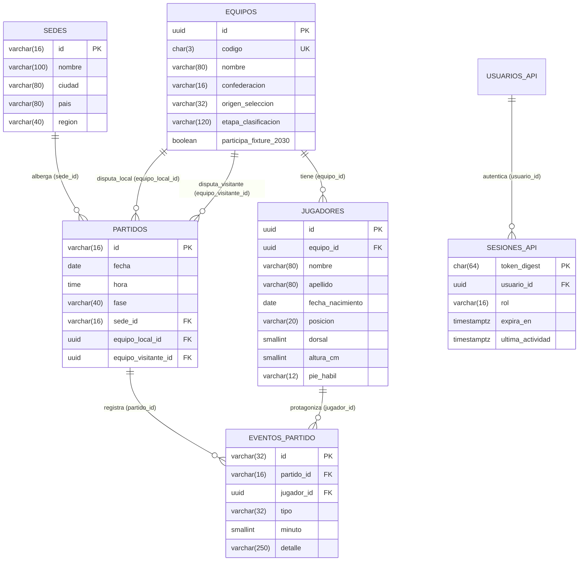

# Comparación Condicionada con una Estructura Relacional — Hito 12

**Asignatura:** Ingeniería de Datos II  
**Proyecto:** Plataforma Fixture Mundial 2030 — Grupo 5  

> **Nota Metodológica (RNF14, §5.6):** En este hito las mediciones experimentales de carga se ejecutaron sobre la arquitectura poli-motor NoSQL real del proyecto (**MongoDB 7.0 + Neo4j 5.x + Redis + Fastify**). La alternativa relacional que se desarrolla a continuación se presenta como un **análisis técnico y arquitectónico riguroso vinculado directamente con el flujo probado**, separando explícitamente el modelo conceptual relacional de las mediciones empíricas obtenidas en el laboratorio.

---

## 1. Modelado del Flujo Seleccionado en una Estructura Relacional (§5.6)

El flujo sometido a carga en el Hito 12 abarca cuatro operaciones:
1. Validación y renovación de sesión en cada request (`Bearer token`).
2. `GET /partidos/:id`: ficha de partido con sede y fichas completas de selección local y visitante.
3. `GET /equipos/:codigo/jugadores?page=1&limit=24`: plantel ordenado por posición y dorsal más conteo total.
4. `GET /partidos/:id/eventos?limit=20`: cronología de eventos deportivos con datos del jugador protagonista.
5. `GET /equipos/:codigo`: ficha de selección individual.

### 1.1. Unidad de Información y Esquema Relacional Equivalente (3FN)
Mientras que en nuestra arquitectura NoSQL la unidad de información está repartida entre **hashes con TTL en memoria** (Redis), **documentos JSON validados** (MongoDB) y **nodos con relaciones direccionadas** (Neo4j), en un motor relacional (por ejemplo, PostgreSQL) la unidad de información sería la **tupla normalizada en Tercera Forma Normal (3FN)** distribuida en **6 tablas relacionales con claves foráneas (`FOREIGN KEY`)**:

### 1.2. Índices y `JOIN`s Necesarios en la Alternativa Relacional

| Operación del Flujo | Operación en la Arquitectura NoSQL Actual | Operación Equivalente en Base Relacional (SQL) | Índices Requeridos en RDBMS |
|:---|:---|:---|:---|
| **Validar y renovar sesión** | Script Lua `READ_AND_RENEW_SESSION` en **Redis** en memoria con `PTTL` + `HSET` + `EXPIRE` nativos. | `UPDATE sesiones_api SET ultima_actividad = NOW(), expira_en = NOW() + INTERVAL '30 minutes' WHERE token_digest = $1 AND expira_en > NOW() RETURNING usuario_id, rol;` + proceso periódico `DELETE FROM sesiones_api WHERE expira_en <= NOW()`. | `PRIMARY KEY (token_digest)` + `INDEX (expira_en)` para purga de expiradas. |
| **`GET /partidos/:id`** | **Línea Base:** 1 Cypher en Neo4j + 2 `findOne` en MongoDB. **Optimizado:** 1 `GET` en Redis Caché (o 1 Cypher + 1 `find($in)` en miss). | **1 sola consulta SQL con 3 `INNER JOIN`:** `SELECT p.*, s.*, el.*, ev.* FROM partidos p JOIN sedes s ON s.id = p.sede_id JOIN equipos el ON el.id = p.equipo_local_id JOIN equipos ev ON ev.id = p.equipo_visitante_id WHERE p.id = $1;` | `PK (partidos.id)`, `PK (sedes.id)`, `PK (equipos.id)`. |
| **`GET /equipos/:codigo/jugadores`** | **Línea Base:** `findOne` en `equipos` + `find` + `countDocuments` en `jugadores`. **Optimizado:** 1 `GET` en Redis Caché (o 1 `find` con proyección). | **1 consulta SQL con `JOIN` y función de ventana:** `SELECT j.*, COUNT(*) OVER() AS total FROM jugadores j JOIN equipos e ON e.id = j.equipo_id WHERE e.codigo = $1 ORDER BY j.posicion, j.dorsal LIMIT 24 OFFSET 0;` | `UNIQUE (equipos.codigo)` + `INDEX (jugadores.equipo_id, posicion, dorsal)`. |
| **`GET /partidos/:id/eventos`** | Recorrido `(e:Evento)-[:OCURRE_EN]->(p:Partido)` y `(e)-[:INVOLUCRA]->(j:Jugador)` en **Neo4j** (o caché Redis 15s). | **1 consulta SQL con 2 `LEFT JOIN`:** `SELECT ep.*, j.nombre, j.apellido, e.codigo FROM partidos p LEFT JOIN eventos_partido ep ON ep.partido_id = p.id LEFT JOIN jugadores j ON j.id = ep.jugador_id LEFT JOIN equipos e ON e.id = j.equipo_id WHERE p.id = $1 ORDER BY ep.minuto, ep.id LIMIT 20;` | `INDEX (eventos_partido.partido_id, minuto, id)` + `PK (jugadores.id)`. |

---

## 2. Garantías de Consistencia, Transacciones y Crecimiento (§5.6)

| Dimensión de Análisis | Arquitectura Poli-Motor NoSQL (MongoDB + Neo4j + Redis) | Alternativa Relacional Unificada (RDBMS — ej. PostgreSQL) |
|:---|:---|:---|
| **Garantías de consistencia e integridad referencial** | **Integridad de aplicación y eventual entre motores:** MongoDB valida el esquema JSON de cada documento pero no impone `FOREIGN KEY` entre `jugadores` y `equipos` ni con Neo4j. La coherencia se verifica mediante scripts (`05-verify.js`, `04-verificacion.cypher`, `validar_integridad.ts`) y la API rechaza respuestas parciales (`503` si un equipo de Neo4j falta en MongoDB). | **Consistencia fuerte ACID e integridad declarativa:** El motor garantiza mediante `FOREIGN KEY` declarativas y transacciones ACID la existencia referencial estricta de las entidades (un jugador debe pertenecer a un equipo existente y un partido debe apuntar a equipos y sedes válidos). No obstante, cabe notar que una `FOREIGN KEY` simple asegura existencia pero no por sí sola que el jugador pertenezca a uno de los dos equipos participantes de ese partido concreto; para imponer dicha pertenencia contextual se requieren restricciones adicionales (claves foráneas compuestas con `(partido_id, equipo_id)`, cláusulas `CHECK` avanzadas o triggers declarativos). |
| **Manejo de sesiones y expiración (TTL)** | **Nativo en memoria (Redis):** La expiración ocurre automáticamente en el diccionario volátil de Redis sin generar *dead tuples* en disco. Sin embargo, realizar `HSET` + `EXPIRE` en cada request requiere amortización (*throttling*) bajo alta frecuencia. | **Costoso bajo carga intensiva de escrituras:** En PostgreSQL (MVCC), cada `UPDATE sesiones_api SET expira_en = ...` en cada request `GET` genera una nueva versión de fila en disco/WAL y deja una tupla muerta que requiere `AUTOVACUUM` constante, pudiendo provocar *table bloat* bajo miles de req/s. |
| **Complejidad de `GET /partidos/:id` (Sin Caché)** | **Más compleja en NoSQL poli-motor:** Requiere coordinar en la capa de aplicación una lectura al grafo (Neo4j) seguida de la búsqueda documental (MongoDB) y manejar fallas parciales entre dos protocolos distintos (Bolt y Wire Protocol). | **Más simple en Relacional:** Se resuelve conceptualmente en una única sentencia SQL con 3 `INNER JOIN` por clave primaria ejecutada dentro del mismo motor. Con un catálogo pequeño (64 equipos y 32 partidos) residente en buffer pool de memoria, se proyecta un tiempo teórico de ejecución mínimo sin saltos de red inter-motor (objetivo de diseño conceptual no medido en laboratorio, §5.6 y RNF14). |
| **Consultas de caminos y relaciones profundas (Hito 5)** | **Más simple y expresiva en Neo4j:** Consultas de longitud variable como `shortestPath((j1:Jugador)-[*]-(j2:Jugador))` o cadenas de compañeros/rivales se expresan de forma declarativa sin conocer de antemano la cantidad de saltos. | **Más compleja en Relacional:** Requiere `WITH RECURSIVE` (CTEs recursivas) con múltiples auto-joins costosos de mantener y optimizar cuando aumenta la profundidad del grafo. |
| **Crecimiento de volumen y concurrencia en otros módulos del Fixture** | Al separar comentarios masivos en **Cassandra** (Hito 6) y series temporales de 10 s en **InfluxDB** (Hito 8), las escrituras de alta tasa no degradan el catálogo de equipos ni los partidos. | Concentrar catálogo, sesiones, millones de comentarios por minuto y telemetría temporal de 10 s en un único RDBMS generaría contención severa de locks, WAL e índices B-Tree. |

---

## 3. Condiciones de Conveniencia: ¿Cuándo elegir cada alternativa? (RF14, §5.6)

### 3.1. ¿En qué condición resulta más conveniente una solución Relacional?
1. **Para el subdominio específico de Catálogo Deportivo y Fixture (`equipos`, `jugadores`, `sedes`, `partidos`, `eventos`):**
   - El volumen de estas entidades es pequeño y acotado (64 equipos, 1.536 jugadores, 127 partidos, unos pocos miles de eventos en todo el torneo).
   - Sus relaciones (`Partido -> Sede`, `Partido -> Equipo Local/Visitante`, `Evento -> Partido/Jugador`) son estructuralmente fijas y requieren integridad referencial estricta.
   - Una base relacional resuelve `GET /partidos/:id` mediante un `JOIN` local de claves primarias sin necesidad de cruzar dos motores por red ni mantener sincronizados CSVs entre MongoDB y Neo4j.

### 3.2. ¿En qué condición resulta más conveniente la solución NoSQL / Políglota?
1. **Para el manejo de Sesiones y Caché de Alta Frecuencia (Redis):**
   - Cuando cada request HTTP autenticado valida sesión y el 80 % de las lecturas se concentra en un conjunto reducido de partidos calientes, **Redis** ofrece expiración nativa en memoria (`PTTL`/`EXPIRE`) y tiempos sub-milisegundo sin penalizar el almacenamiento en disco con transacciones MVCC.
2. **Para Exploración de Grafos de Profundidad Variable (Neo4j) o Documentos Polimórficos (MongoDB):**
   - Cuando las consultas principales son recorridos de caminos arbitrarios entre jugadores, árbitros, sedes e historial de enfrentamientos (`shortestPath`, centralidad), o cuando las fichas documentales varían significativamente de estructura entre confederaciones/versiones sin esquema tabular rígido.
3. **Para Ingesta Masiva de Comentarios (Cassandra) y Telemetría Temporal (InfluxDB):**
   - Donde el patrón de escritura continua append-only y particionamiento horizontal por `(partido_id, bucket_minuto, grupo)` o compresión columnar por tiempo supera la capacidad de ingesta de una tabla relacional tradicional.

---

## 4. Aspectos No Medidos en el Laboratorio (§5.6, RNF14)

- **No se ejecutó un contenedor PostgreSQL/MySQL en paralelo durante esta prueba:** Las cifras de latencia y throughput reportadas en `docs/evidencia/` corresponden exclusivamente a mediciones reales sobre **Fastify + Redis + Neo4j + MongoDB**.
- **No se midieron escrituras transaccionales concurrentes con `JOIN` ni `AUTOVACUUM` bajo carga:** El análisis del impacto de MVCC en sesiones y de los `INNER JOIN` por clave primaria se fundamenta en la arquitectura de motores relacionales y en el patrón de acceso específico del flujo, sin inventar cifras de milisegundos para un motor relacional no ejecutado.
