# Tablas y Gráficos Comparativos: Línea Base vs. Optimizado (Hito 12)

Este documento consolida la comparación verificable entre la **Línea Base** (`baseline`) y la **Prueba Optimizada** (`optimized`) bajo el mismo escenario reproducible de carga (RF9, RF10, RNF3, RNF5).

- **Fecha corrida Línea Base:** `2026-10-30T14:56:01.876Z` (Commit `5533d42`, estado: `clean`)
- **Fecha corrida Optimizada:** `2026-10-30T14:56:55.226Z` (Commit `5533d42`, estado: `clean`)
- **Condiciones configuradas:** Concurrencia = **24 VUs**, Semilla PRNG = `203012`, Warm-up = 3 s, Ramp-up = 4 s, Sostenimiento = 12 s, Tope de seguridad = 50000 ops, Distribución Hotspot 80/20.
- **Ventana observada Línea Base:** `16.125 s` (Ramp-up observado: `4 s`, Sostenimiento observado: `12.125 s`, Motivo de cierre: `TIME_WINDOW_COMPLETED`)
- **Ventana observada Optimizada:** `16.018 s` (Ramp-up observado: `4 s`, Sostenimiento observado: `12.018 s`, Motivo de cierre: `TIME_WINDOW_COMPLETED`)

---

## 1. Tabla Comparativa Global (Antes vs. Después) (RF10)

| Métrica / Indicador | Unidad | Línea Base (`baseline`) | Flujo Optimizado (`optimized`) | Variación Relativa | Interpretación |
|:---|:---:|---:|---:|---:|:---|
| **Duración de Ventana Medida** | s | 16.125 | **16.018** | **-0.7 %** | Cierre: `TIME_WINDOW_COMPLETED` vs. `TIME_WINDOW_COMPLETED` (sostenimiento completo: `true` / `true`) |
| **Operaciones Totales Generadas** | ops | 2009 | **8249** | **+310.6 %** | Volumen procesado en ventana observada (16.1 s base vs. 16.0 s opt) |
| **Operaciones Exitosas (`HTTP 200`)** | ops | 2009 | **8249** | **+310.6 %** | 100.00 % base vs. 100.00 % opt de respuestas válidas con integridad comprobada (0 fallos en ambas corridas) |
| **Tasa de Error** | % | 0 % | **0 %** | 0.00 pp | 0 errores HTTP y 0 errores de integridad observados en ambas corridas |
| **Throughput Global Sostenido** | ops/s | 124.59 | **514.98** | **+313.3 %** | Variación de caudal medida bajo efecto conjunto del paquete aplicado (O1+O2+O3) |
| **Latencia Media E2E** | ms | 172.95 | **41.892** | **-75.8 %** | Variación del tiempo medio de respuesta al cliente (efecto conjunto O1–O3) |
| **Latencia p50 (Mediana) E2E** | ms | 167.838 | **39.298** | **-76.6 %** | Variación en la mediana de latencia bajo distribución Pareto 80/20 |
| **Latencia p90 E2E** | ms | 247.187 | **54.375** | **-78.0 %** | Variación del percentil 90 bajo 24 VUs concurrentes (efecto conjunto O1–O3) |
| **Latencia p95 E2E** | ms | 308.75 | **65.572** | **-78.8 %** | Variación del percentil 95 extremo a extremo bajo efecto conjunto (O1–O3) |
| **Latencia p99 E2E** | ms | 532.104 | **83.586** | **-84.3 %** | Variación del percentil 99 de cola extremo a extremo (efecto conjunto O1–O3) |
| **Latencia Máxima E2E** | ms | 756.323 | **254.803** | **-66.3 %** | Valor extremo puntual observado en la muestra (sin aislamiento individual de causa) |
| **Latencia p95 Claves Calientes (80 %)** | ms | 304.542 | **61.587** | **-79.8 %** | Tráfico concentrado en 4 partidos y 8 equipos; servido mayoritariamente desde caché Read-Aside tras el primer miss |
| **Latencia p95 Claves Frías (20 %)** | ms | 340.348 | **72.343** | **-78.7 %** | Efecto conjunto (O1+O2+O3): claves de baja frecuencia de selección PRNG que se cachean tras su primer acceso y comparten motores descargados |

---

## 2. Comparación por Perfil de Endpoint HTTP

| Endpoint | Throughput Base (ops/s) | Throughput Opt. (ops/s) | p50 Base (ms) | p50 Opt. (ms) | p95 Base (ms) | p95 Opt. (ms) | p99 Base (ms) | p99 Opt. (ms) |
|:---|---:|---:|---:|---:|---:|---:|---:|---:|
| `GET /partidos/:id` | 50.23 | **208.52** (+315.1 %) | 179.245 | **39.011** (-78.2 %) | 417.604 | **59.855** (-85.7 %) | 630.289 | **79.499** (-87.4 %) |
| `GET /equipos/:codigo/jugadores?page=1&limit=24` | 36.9 | **153.2** (+315.2 %) | 195.359 | **39.648** (-79.7 %) | 279.189 | **67.092** (-76.0 %) | 366.64 | **86.379** (-76.4 %) |
| `GET /partidos/:id/eventos?limit=20` | 25.86 | **102.14** (+295.0 %) | 111.358 | **39.44** (-64.6 %) | 433.125 | **67.185** (-84.5 %) | 595.518 | **89.053** (-85.0 %) |
| `GET /equipos/:codigo` | 11.6 | **51.13** (+340.8 %) | 125.796 | **39.021** (-69.0 %) | 190.517 | **67.616** (-64.5 %) | 232.487 | **84.42** (-63.7 %) |

---

## 3. Comparación de Carga Interna sobre Motores NoSQL y Recursos (Instantáneas Snapshot Post-Prueba) (RF6, RF10, RF11)

| Motor / Recurso | Métrica | Línea Base (`baseline`) | Flujo Optimizado (`optimized`) | Variación / Efecto |
|:---|:---|---:|---:|:---|
| **MongoDB** | Consultas ejecutadas al motor | 3592 | **83** | **-97.7 %** de variación en llamadas al motor documental |
| **MongoDB** | Latencia p95 del driver | 109.793 ms | **33.85 ms** | **-69.2 %** en las consultas restantes (efecto conjunto O1+O2, pool `5` -> `25`) |
| **Neo4j** | Consultas Cypher ejecutadas | 1227 | **43** | **-96.5 %** de variación en llamadas al motor de grafos |
| **Neo4j** | Latencia p95 del driver Bolt | 355.53 ms | **48.454 ms** | **-86.4 %** en las consultas restantes (efecto conjunto O1+O2, pool `5` -> `25`) |
| **Redis (Sesiones)** | Evaluaciones Lua de sesión | 2009 | **8249** | +310.6 % (1 por request HTTP) |
| **Redis (Sesiones)** | Escrituras `HSET`+`EXPIRE` ejecutadas | 2009 | **0** | **0 -> 8249** escrituras omitidas por ventana de throttle (60 s) |
| **Redis (Caché Read-Aside)** | Hit Ratio de Caché | 0 % (Inactivo) | **98.57 %** | **8131 hits** / 118 misses (118 escrituras) |
| **Redis (Memoria)** | Memoria usada post-prueba (`used_memory`) | 1.81M (1901008 B) | **2.42M (2536848 B)** | Instantánea post-prueba (`INFO memory`) con claves de caché activas |
| **Node.js (Proceso)** | Memoria RSS final | 219.94 MiB | **327.32 MiB** | Instantánea RSS al cierre del proceso (+48.8 %, sin atribución aislada) |

---

## 4. Representación Gráfica de Resultados (Mermaid XY Charts)

### 4.1. Comparación de Percentiles de Latencia E2E (ms — menor es mejor)

```mermaid
xychart-beta
    title "Latencia Extremo a Extremo (ms): Linea Base vs Optimizado"
    x-axis ["Media", "p50 (Mediana)", "p90", "p95", "p99"]
    y-axis "Latencia (ms)" 0 --> 612
    bar [172.95, 167.838, 247.187, 308.75, 532.104]
    bar [41.892, 39.298, 54.375, 65.572, 83.586]
```

> *Primera serie de barras: Línea Base (`baseline`). Segunda serie de barras: Flujo Optimizado (`optimized`).*

### 4.2. Comparación de Throughput por Perfil (ops/s — mayor es mejor)

```mermaid
xychart-beta
    title "Throughput Sostenido (ops/s): Linea Base vs Optimizado"
    x-axis ["Global", "GET /partidos/:id", "GET /jugadores", "GET /eventos", "GET /equipos/:cod"]
    y-axis "Operaciones / seg" 0 --> 593
    bar [124.59, 50.23, 36.9, 25.86, 11.6]
    bar [514.98, 208.52, 153.2, 102.14, 51.13]
```

---
*Generado automáticamente por `ejecutar_prueba_optimizada.ts` a partir de las mediciones reales de laboratorio (RNF14).*