# Tablas y Gráficos Comparativos: Línea Base vs. Optimizado (Hito 12)

Este documento consolida la comparación verificable entre la **Línea Base** (`baseline`) y la **Prueba Optimizada** (`optimized`) bajo el mismo escenario reproducible de carga (RF9, RF10, RNF3, RNF5).

- **Fecha corrida Línea Base:** `2026-10-30T12:58:10.366Z` (Commit `acb8fc0`, estado: `clean`)
- **Fecha corrida Optimizada:** `2026-10-30T12:59:05.508Z` (Commit `acb8fc0`, estado: `clean`)
- **Condiciones configuradas:** Concurrencia = **24 VUs**, Semilla PRNG = `203012`, Warm-up = 3 s, Ramp-up = 4 s, Sostenimiento = 12 s, Tope de seguridad = 50000 ops, Distribución Hotspot 80/20.
- **Ventana observada Línea Base:** `16.084 s` (Ramp-up observado: `4 s`, Sostenimiento observado: `12.084 s`, Motivo de cierre: `TIME_WINDOW_COMPLETED`)
- **Ventana observada Optimizada:** `16.029 s` (Ramp-up observado: `4 s`, Sostenimiento observado: `12.029 s`, Motivo de cierre: `TIME_WINDOW_COMPLETED`)

---

## 1. Tabla Comparativa Global (Antes vs. Después) (RF10)

| Métrica / Indicador | Unidad | Línea Base (`baseline`) | Flujo Optimizado (`optimized`) | Variación Relativa | Interpretación |
|:---|:---:|---:|---:|---:|:---|
| **Duración de Ventana Medida** | s | 16.084 | **16.029** | **-0.3 %** | Cierre: `TIME_WINDOW_COMPLETED` vs. `TIME_WINDOW_COMPLETED` (sostenimiento completo: `true` / `true`) |
| **Operaciones Totales Generadas** | ops | 2227 | **7129** | **+220.1 %** | Mayor capacidad procesada durante la ventana completa (16.1 s base vs. 16.0 s opt) |
| **Operaciones Exitosas (`HTTP 200`)** | ops | 2227 | **7129** | **+220.1 %** | 100 % de respuestas válidas con integridad comprobada |
| **Tasa de Error** | % | 0 % | **0 %** | 0 pp | Cero pérdida ni degradación HTTP |
| **Throughput Global Sostenido** | ops/s | 138.46 | **444.76** | **+221.2 %** | Incremento sustancial de caudal por eliminación de contención y lecturas redundantes |
| **Latencia Media E2E** | ms | 155.692 | **48.5** | **-68.8 %** | Reducción del tiempo medio de respuesta al cliente |
| **Latencia p50 (Mediana) E2E** | ms | 157.768 | **43.478** | **-72.4 %** | Mejora en el caso típico (dominado por claves calientes) |
| **Latencia p90 E2E** | ms | 210.811 | **59.541** | **-71.8 %** | Reducción del encolamiento bajo concurrencia de 24 VUs |
| **Latencia p95 E2E** | ms | 242.841 | **87.16** | **-64.1 %** | Mitigación de espera en pools de MongoDB y Neo4j |
| **Latencia p99 E2E** | ms | 380.44 | **178.09** | **-53.2 %** | Reducción de la cola extrema de latencia |
| **Latencia Máxima E2E** | ms | 677.89 | **340.889** | **-49.7 %** | Pico aislado de cold-miss / GC |
| **Latencia p95 Claves Calientes (80 %)** | ms | 237.75 | **86.587** | **-63.6 %** |Servidas mayoritariamente desde caché Read-Aside en Redis |
| **Latencia p95 Claves Frías (20 %)** | ms | 263.206 | **89.258** | **-66.1 %** | Efecto conjunto (O1+O2): claves de baja frecuencia que tras su primer miss se benefician de pools ampliados, proyección BSON y caché subsecuente |

---

## 2. Comparación por Perfil de Endpoint HTTP

| Endpoint | Throughput Base (ops/s) | Throughput Opt. (ops/s) | p50 Base (ms) | p50 Opt. (ms) | p95 Base (ms) | p95 Opt. (ms) | p99 Base (ms) | p99 Opt. (ms) |
|:---|---:|---:|---:|---:|---:|---:|---:|---:|
| `GET /partidos/:id` | 56.02 | **180.67** (+222.5 %) | 163.44 | **43.185** (-73.6 %) | 263.111 | **89.016** (-66.2 %) | 380.44 | **192.822** (-49.3 %) |
| `GET /equipos/:codigo/jugadores?page=1&limit=24` | 41.35 | **132.07** (+219.4 %) | 185.362 | **43.731** (-76.4 %) | 247.483 | **86.748** (-64.9 %) | 442.563 | **178.432** (-59.7 %) |
| `GET /partidos/:id/eventos?limit=20` | 28.48 | **88.09** (+209.3 %) | 100.227 | **43.435** (-56.7 %) | 189.794 | **85.771** (-54.8 %) | 304.858 | **135.003** (-55.7 %) |
| `GET /equipos/:codigo` | 12.62 | **43.92** (+248.0 %) | 116.867 | **43.547** (-62.7 %) | 150.017 | **87.068** (-42.0 %) | 177.849 | **145.593** (-18.1 %) |

---

## 3. Comparación de Carga Interna sobre Motores NoSQL y Recursos (Instantáneas Snapshot Post-Prueba) (RF6, RF10, RF11)

| Motor / Recurso | Métrica | Línea Base (`baseline`) | Flujo Optimizado (`optimized`) | Variación / Efecto |
|:---|:---|---:|---:|:---|
| **MongoDB 7.0** | Consultas ejecutadas al motor | 4000 | **84** | **-97.9 %** de descarga sobre el motor documental |
| **MongoDB 7.0** | Latencia p95 del driver | 94.668 ms | **25.591 ms** | **-73.0 %** (Pool `5` -> `25` + proyección + `$in`) |
| **Neo4j 5.x** | Consultas Cypher ejecutadas | 1359 | **47** | **-96.5 %** de descarga sobre el motor de grafos |
| **Neo4j 5.x** | Latencia p95 del driver Bolt | 101.74 ms | **74.836 ms** | **-26.4 %** (Pool `5` -> `25` + menor contención) |
| **Redis (Sesiones)** | Evaluaciones Lua de sesión | 2227 | **7129** | +220.1 % (1 por request HTTP) |
| **Redis (Sesiones)** | Escrituras `HSET`+`EXPIRE` ejecutadas | 2227 | **0** | **0 -> 7129** escrituras evitadas por throttle de 60 s |
| **Redis (Caché Read-Aside)** | Hit Ratio de Caché | 0 % (Inactivo) | **98.27 %** | **7006 hits** / 123 misses (123 escrituras) |
| **Redis (Memoria)** | Memoria usada post-prueba (`used_memory`) | 1.79M (1877248 B) | **2.43M (2547080 B)** | Trade-off de memoria en RAM para alojar claves de caché con TTL |
| **Node.js (Proceso)** | Memoria RSS final | 233.89 MiB | **274.21 MiB** | Incremento acotado por pools de conexión más amplios |

---

## 4. Representación Gráfica de Resultados (Mermaid XY Charts)

### 4.1. Comparación de Percentiles de Latencia E2E (ms — menor es mejor)

```mermaid
xychart-beta
    title "Latencia Extremo a Extremo (ms): Linea Base vs Optimizado"
    x-axis ["Media", "p50 (Mediana)", "p90", "p95", "p99"]
    y-axis "Latencia (ms)" 0 --> 438
    bar [155.692, 157.768, 210.811, 242.841, 380.44]
    bar [48.5, 43.478, 59.541, 87.16, 178.09]
```

> *Primera serie de barras: Línea Base (`baseline`). Segunda serie de barras: Flujo Optimizado (`optimized`).*

### 4.2. Comparación de Throughput por Perfil (ops/s — mayor es mejor)

---
*Generado automáticamente por `ejecutar_prueba_optimizada.ts` a partir de las mediciones reales de laboratorio (RNF14).*