# Tablas y Gráficos Comparativos: Línea Base vs. Optimizado (Hito 12)

Este documento consolida la comparación verificable entre la **Línea Base** (`baseline`) y la **Prueba Optimizada** (`optimized`) bajo el mismo escenario reproducible de carga (RF9, RF10, RNF3, RNF5).

- **Fecha corrida Línea Base:** `2026-10-29T23:25:34.080Z` (Commit `abaec7c`)
- **Fecha corrida Optimizada:** `2026-10-29T23:36:26.920Z` (Commit `abaec7c`)
- **Condiciones invariantes:** Concurrencia = **24 VUs**, Semilla PRNG = `203012`, Warm-up = 3 s, Ramp-up = 4 s, Sostenimiento = 12 s, Distribución Hotspot 80/20.

---

## 1. Tabla Comparativa Global (Antes vs. Después) (RF10)

| Métrica / Indicador | Unidad | Línea Base (`baseline`) | Flujo Optimizado (`optimized`) | Variación Relativa | Interpretación |
|:---|:---:|---:|---:|---:|:---|
| **Operaciones Totales Generadas** | ops | 3584 | **5000** | **+39.5 %** | Mayor capacidad procesada en la misma ventana de 16 s |
| **Operaciones Exitosas (`HTTP 200`)** | ops | 3584 | **5000** | **+39.5 %** | 100 % de respuestas válidas con integridad comprobada |
| **Tasa de Error** | % | 0 % | **0 %** | 0 pp | Cero pérdida ni degradación HTTP |
| **Throughput Global Sostenido** | ops/s | 221.85 | **840.34** | **+278.8 %** | Incremento sustancial de caudal por eliminación de contención y lecturas redundantes |
| **Latencia Media E2E** | ms | 96.701 | **20.864** | **-78.4 %** | Reducción del tiempo medio de respuesta al cliente |
| **Latencia p50 (Mediana) E2E** | ms | 79.224 | **17.64** | **-77.7 %** | Mejora en el caso típico (dominado por claves calientes) |
| **Latencia p90 E2E** | ms | 164.868 | **24.352** | **-85.2 %** | Reducción del encolamiento bajo concurrencia de 24 VUs |
| **Latencia p95 E2E** | ms | 231.733 | **33.982** | **-85.3 %** | Mitigación de espera en pools de MongoDB y Neo4j |
| **Latencia p99 E2E** | ms | 423.238 | **96.889** | **-77.1 %** | Reducción de la cola extrema de latencia |
| **Latencia Máxima E2E** | ms | 587.841 | **423.174** | **-28.0 %** | Pico aislado de cold-miss / GC |
| **Latencia p95 Claves Calientes (80 %)** | ms | 229.864 | **29.443** | **-87.2 %** |Servidas mayoritariamente desde caché Read-Aside en Redis |
| **Latencia p95 Claves Frías (20 %)** | ms | 240.029 | **37.892** | **-84.2 %** | Efecto conjunto (O1+O2): claves de baja frecuencia que tras su primer miss se benefician de pools ampliados, proyección BSON y caché subsecuente |

---

## 2. Comparación por Perfil de Endpoint HTTP

| Endpoint | Throughput Base (ops/s) | Throughput Opt. (ops/s) | p50 Base (ms) | p50 Opt. (ms) | p95 Base (ms) | p95 Opt. (ms) | p99 Base (ms) | p99 Opt. (ms) |
|:---|---:|---:|---:|---:|---:|---:|---:|---:|
| `GET /partidos/:id` | 88.83 | **339.5** (+282.2 %) | 85.771 | **17.626** (-79.4 %) | 236.94 | **28.154** (-88.1 %) | 422.329 | **131.777** (-68.8 %) |
| `GET /equipos/:codigo/jugadores?page=1&limit=24` | 66.98 | **252.77** (+277.4 %) | 95.927 | **17.74** (-81.5 %) | 296.273 | **32.561** (-89.0 %) | 490.29 | **85.31** (-82.6 %) |
| `GET /partidos/:id/eventos?limit=20` | 44.63 | **165.21** (+270.2 %) | 53.918 | **17.574** (-67.4 %) | 168.794 | **37.759** (-77.6 %) | 263.477 | **134.332** (-49.0 %) |
| `GET /equipos/:codigo` | 21.42 | **82.86** (+286.8 %) | 61.558 | **17.547** (-71.5 %) | 163.065 | **34.8** (-78.7 %) | 281.01 | **84.563** (-69.9 %) |

---

## 3. Comparación de Carga Interna sobre Motores NoSQL y Recursos (Instantáneas Snapshot Post-Prueba) (RF6, RF10, RF11)

| Motor / Recurso | Métrica | Línea Base (`baseline`) | Flujo Optimizado (`optimized`) | Variación / Efecto |
|:---|:---|---:|---:|:---|
| **MongoDB 7.0** | Consultas ejecutadas al motor | 6462 | **38** | **-99.4 %** de descarga sobre el motor documental |
| **MongoDB 7.0** | Latencia p95 del driver | 97.895 ms | **16.385 ms** | **-83.3 %** (Pool `5` -> `25` + proyección + `$in`) |
| **Neo4j 5.x** | Consultas Cypher ejecutadas | 2156 | **15** | **-99.3 %** de descarga sobre el motor de grafos |
| **Neo4j 5.x** | Latencia p95 del driver Bolt | 77.987 ms | **325.788 ms** | **+317.7 %** (Pool `5` -> `25` + menor contención) |
| **Redis (Sesiones)** | Evaluaciones Lua de sesión | 3584 | **5000** | +39.5 % (1 por request HTTP) |
| **Redis (Sesiones)** | Escrituras `HSET`+`EXPIRE` ejecutadas | 3584 | **0** | **0 -> 5000** escrituras evitadas por throttle de 60 s |
| **Redis (Caché Read-Aside)** | Hit Ratio de Caché | 0 % (Inactivo) | **98.96 %** | **4948 hits** / 52 misses (52 escrituras) |
| **Redis (Memoria)** | Memoria usada post-prueba (`used_memory`) | 1.77M (1855464 B) | **2.43M (2545984 B)** | Trade-off de memoria en RAM para alojar claves de caché con TTL |
| **Node.js (Proceso)** | Memoria RSS final | 259.21 MiB | **271.14 MiB** | Incremento acotado por pools de conexión más amplios |

---

## 4. Representación Gráfica de Resultados (Mermaid XY Charts)

### 4.1. Comparación de Percentiles de Latencia E2E (ms — menor es mejor)

```mermaid
xychart-beta
    title "Latencia Extremo a Extremo (ms): Linea Base vs Optimizado"
    x-axis ["Media", "p50 (Mediana)", "p90", "p95", "p99"]
    y-axis "Latencia (ms)" 0 --> 487
    bar [96.701, 79.224, 164.868, 231.733, 423.238]
    bar [20.864, 17.64, 24.352, 33.982, 96.889]
```

> *Primera serie de barras: Línea Base (`baseline`). Segunda serie de barras: Flujo Optimizado (`optimized`).*

### 4.2. Comparación de Throughput por Perfil (ops/s — mayor es mejor)

---
*Generado automáticamente por `ejecutar_prueba_optimizada.ts` a partir de las mediciones reales de laboratorio (RNF14).*