# Tablas y Gráficos Comparativos: Línea Base vs. Optimizado (Hito 12)

Este documento consolida la comparación verificable entre la **Línea Base** (`baseline`) y la **Prueba Optimizada** (`optimized`) bajo el mismo escenario reproducible de carga (RF9, RF10, RNF3, RNF5).

- **Fecha corrida Línea Base:** `2026-10-24T05:37:27.018Z` (Commit `d350d50`)
- **Fecha corrida Optimizada:** `2026-10-26T21:08:10.808Z` (Commit `d350d50`)
- **Condiciones invariantes:** Concurrencia = **24 VUs**, Semilla PRNG = `203012`, Warm-up = 3 s, Ramp-up = 4 s, Sostenimiento = 12 s, Distribución Hotspot 80/20.

---

## 1. Tabla Comparativa Global (Antes vs. Después) (RF10)

| Métrica / Indicador | Unidad | Línea Base (`baseline`) | Flujo Optimizado (`optimized`) | Variación Relativa | Interpretación |
|:---|:---:|---:|---:|---:|:---|
| **Operaciones Totales Generadas** | ops | 635 | **4439** | **+599.1 %** | Mayor capacidad procesada en la misma ventana de 18 s |
| **Operaciones Exitosas (`HTTP 200`)** | ops | 566 | **4439** | **+684.3 %** | 100 % de respuestas válidas con integridad comprobada |
| **Tasa de Error** | % | 10.87 % | **0 %** | -10.87 pp | Cero pérdida ni degradación HTTP |
| **Throughput Global Sostenido** | ops/s | 34.96 | **276.94** | **+692.2 %** | Incremento sustancial de caudal por eliminación de contención y lecturas redundantes |
| **Latencia Media E2E** | ms | 606.008 | **77.879** | **-87.1 %** | Reducción del tiempo medio de respuesta al cliente |
| **Latencia p50 (Mediana) E2E** | ms | 267.811 | **65.834** | **-75.4 %** | Mejora en el caso típico (dominado por claves calientes) |
| **Latencia p90 E2E** | ms | 2014.118 | **126.178** | **-93.7 %** | Reducción del encolamiento bajo concurrencia de 24 VUs |
| **Latencia p95 E2E** | ms | 2039.774 | **159.28** | **-92.2 %** | Mitigación de espera en pools de MongoDB y Neo4j |
| **Latencia p99 E2E** | ms | 3922.693 | **245.069** | **-93.8 %** | Reducción de la cola extrema de latencia |
| **Latencia Máxima E2E** | ms | 5149.397 | **1764.444** | **-65.7 %** | Pico aislado de cold-miss / GC |
| **Latencia p95 Claves Calientes (80 %)** | ms | 2039.031 | **146.464** | **-92.8 %** |Servidas mayoritariamente desde caché Read-Aside en Redis |
| **Latencia p95 Claves Frías (20 %)** | ms | 2019.902 | **211.781** | **-89.5 %** | Beneficiadas por mayor pool (`25`), proyección BSON y consulta `$in` |

---

## 2. Comparación por Perfil de Endpoint HTTP

| Endpoint | Throughput Base (ops/s) | Throughput Opt. (ops/s) | p50 Base (ms) | p50 Opt. (ms) | p95 Base (ms) | p95 Opt. (ms) | p99 Base (ms) | p99 Opt. (ms) |
|:---|---:|---:|---:|---:|---:|---:|---:|---:|
| `GET /partidos/:id` | 14.59 | **110.92** (+660.2 %) | 423.882 | **64.998** (-84.7 %) | 2050.251 | **148.183** (-92.8 %) | 5003.734 | **245.045** (-95.1 %) |
| `GET /equipos/:codigo/jugadores?page=1&limit=24` | 10.02 | **84.91** (+747.4 %) | 197.952 | **65.658** (-66.8 %) | 298.205 | **155.993** (-47.7 %) | 335.868 | **215.037** (-36.0 %) |
| `GET /partidos/:id/eventos?limit=20` | 7.49 | **54.28** (+624.7 %) | 291.269 | **66.889** (-77.0 %) | 2071.892 | **186.515** (-91.0 %) | 5000.532 | **264.871** (-94.7 %) |
| `GET /equipos/:codigo` | 2.86 | **26.83** (+838.1 %) | 114.668 | **66.845** (-41.7 %) | 220.775 | **185.188** (-16.1 %) | 252.942 | **262.856** (+3.9 %) |

---

## 3. Comparación de Carga Interna sobre Motores NoSQL y Recursos (RF6, RF10, RF11)

| Motor / Recurso | Métrica | Línea Base (`baseline`) | Flujo Optimizado (`optimized`) | Variación / Efecto |
|:---|:---|---:|---:|:---|
| **MongoDB 7.0** | Consultas ejecutadas al motor | 1034 | **118** | **-88.6 %** de descarga sobre el motor documental |
| **MongoDB 7.0** | Latencia p95 del driver | 122.45 ms | **56.816 ms** | **-53.6 %** (Pool `5` -> `25` + proyección + `$in`) |
| **Neo4j 5.x** | Consultas Cypher ejecutadas | 401 | **60** | **-85.0 %** de descarga sobre el motor de grafos |
| **Neo4j 5.x** | Latencia p95 del driver Bolt | 2012.273 ms | **276.867 ms** | **-86.2 %** (Pool `5` -> `25` + menor contención) |
| **Redis (Sesiones)** | Evaluaciones Lua de sesión | 635 | **4439** | +599.1 % (1 por request HTTP) |
| **Redis (Sesiones)** | Escrituras `HSET`+`EXPIRE` ejecutadas | 635 | **0** | **0 -> 4439** escrituras evitadas por throttle de 60 s |
| **Redis (Caché Read-Aside)** | Hit Ratio de Caché | 0 % (Inactivo) | **96.53 %** | **4285 hits** / 154 misses (154 escrituras) |
| **Redis (Memoria)** | Memoria usada post-prueba (`used_memory`) | 1.70M (1786960 B) | **2.35M (2464624 B)** | Trade-off de memoria en RAM para alojar claves de caché con TTL |
| **Node.js (Proceso)** | Memoria RSS final | 160.52 MiB | **178.53 MiB** | Incremento acotado por pools de conexión más amplios |

---

## 4. Representación Gráfica de Resultados (Mermaid XY Charts)

### 4.1. Comparación de Percentiles de Latencia E2E (ms — menor es mejor)

```mermaid
xychart-beta
    title "Latencia Extremo a Extremo (ms): Linea Base vs Optimizado"
    x-axis ["Media", "p50 (Mediana)", "p90", "p95", "p99"]
    y-axis "Latencia (ms)" 0 --> 4512
    bar [606.008, 267.811, 2014.118, 2039.774, 3922.693]
    bar [77.879, 65.834, 126.178, 159.28, 245.069]
```

> *Primera serie de barras: Línea Base (`baseline`). Segunda serie de barras: Flujo Optimizado (`optimized`).*

### 4.2. Comparación de Throughput por Perfil (ops/s — mayor es mejor)

```mermaid
xychart-beta
    title "Throughput Sostenido (ops/s): Linea Base vs Optimizado"
    x-axis ["Global", "GET /partidos/:id", "GET /jugadores", "GET /eventos", "GET /equipos/:cod"]
    y-axis "Operaciones / seg" 0 --> 319
    bar [34.96, 14.59, 10.02, 7.49, 2.86]
    bar [276.94, 110.92, 84.91, 54.28, 26.83]
```

---
*Generado automáticamente por `ejecutar_prueba_optimizada.ts` a partir de las mediciones reales de laboratorio (RNF14).*