# Tablas y Gráficos Comparativos: Línea Base vs. Optimizado (Hito 12)

Este documento consolida la comparación verificable entre la **Línea Base** (`baseline`) y la **Prueba Optimizada** (`optimized`) bajo el mismo escenario reproducible de carga (RF9, RF10, RNF3, RNF5).

- **Fecha corrida Línea Base:** `2026-11-06T18:42:56.624Z` (Commit `cd653d6`, estado: `clean`)
- **Fecha corrida Optimizada:** `2026-11-06T18:44:14.293Z` (Commit `cd653d6`, estado: `clean`)
- **Condiciones configuradas:** Concurrencia = **24 VUs**, Semilla PRNG = `203012`, Warm-up = 3 s, Ramp-up = 4 s, Sostenimiento = 12 s, Tope de seguridad = 500000 ops, Distribución Hotspot 80/20.
- **Ventana observada Línea Base:** `16.012 s` (Ramp-up observado: `4 s`, Sostenimiento observado: `12.012 s`, Motivo de cierre: `TIME_WINDOW_COMPLETED`)
- **Ventana observada Optimizada:** `16.002 s` (Ramp-up observado: `4 s`, Sostenimiento observado: `12.002 s`, Motivo de cierre: `TIME_WINDOW_COMPLETED`)

---

## 1. Tabla Comparativa Global (Antes vs. Después) (RF10)

| Métrica / Indicador | Unidad | Línea Base (`baseline`) | Flujo Optimizado (`optimized`) | Variación Relativa | Interpretación |
|:---|:---:|---:|---:|---:|:---|
| **Duración de Ventana Medida** | s | 16.012 | **16.002** | **-0.1 %** | Cierre: `TIME_WINDOW_COMPLETED` vs. `TIME_WINDOW_COMPLETED` (sostenimiento completo: `true` / `true`) |
| **Operaciones Totales Generadas** | ops | 17669 | **63452** | **+259.1 %** | Volumen procesado en ventana observada (16.0 s base vs. 16.0 s opt) |
| **Operaciones Exitosas (`HTTP 200`)** | ops | 17669 | **63452** | **+259.1 %** | 100.00 % base vs. 100.00 % opt de respuestas válidas con integridad comprobada (0 fallos en ambas corridas) |
| **Tasa de Error** | % | 0 % | **0 %** | 0.00 pp | 0 errores HTTP y 0 errores de integridad observados en ambas corridas |
| **Throughput Global Sostenido** | ops/s | 1103.48 | **3965.25** | **+259.3 %** | Variación de caudal medida bajo efecto conjunto del paquete aplicado (O1+O2+O3) |
| **Latencia Media E2E** | ms | 19.57 | **5.438** | **-72.2 %** | Variación del tiempo medio de respuesta al cliente (efecto conjunto O1–O3) |
| **Latencia p50 (Mediana) E2E** | ms | 19.573 | **5.325** | **-72.8 %** | Variación en la mediana de latencia bajo distribución Pareto 80/20 |
| **Latencia p90 E2E** | ms | 28.929 | **6.099** | **-78.9 %** | Variación del percentil 90 bajo 24 VUs concurrentes (efecto conjunto O1–O3) |
| **Latencia p95 E2E** | ms | 31.381 | **9.254** | **-70.5 %** | Variación del percentil 95 extremo a extremo bajo efecto conjunto (O1–O3) |
| **Latencia p99 E2E** | ms | 36.682 | **11.368** | **-69.0 %** | Variación del percentil 99 de cola extremo a extremo (efecto conjunto O1–O3) |
| **Latencia Máxima E2E** | ms | 61.851 | **87.317** | **+41.2 %** | Valor extremo puntual observado en la muestra (sin aislamiento individual de causa) |
| **Latencia p95 Claves Calientes (80 %)** | ms | 31.497 | **9.187** | **-70.8 %** | Tráfico concentrado en 4 partidos y 8 equipos; servido mayoritariamente desde caché Read-Aside tras el primer miss |
| **Latencia p95 Claves Frías (20 %)** | ms | 30.767 | **9.406** | **-69.4 %** | Efecto conjunto (O1+O2+O3): claves de baja frecuencia de selección PRNG que se cachean tras su primer acceso y comparten motores descargados |

---

## 2. Comparación por Perfil de Endpoint HTTP

| Endpoint | Throughput Base (ops/s) | Throughput Opt. (ops/s) | p50 Base (ms) | p50 Opt. (ms) | p95 Base (ms) | p95 Opt. (ms) | p99 Base (ms) | p99 Opt. (ms) |
|:---|---:|---:|---:|---:|---:|---:|---:|---:|
| `GET /partidos/:id` | 446.67 | **1592.74** (+256.6 %) | 20.122 | **5.296** (-73.7 %) | 27.838 | **8.842** (-68.2 %) | 32.726 | **11.316** (-65.4 %) |
| `GET /equipos/:codigo/jugadores?page=1&limit=24` | 330.38 | **1184.04** (+258.4 %) | 26.22 | **5.371** (-79.5 %) | 34.881 | **10.048** (-71.2 %) | 39.065 | **11.743** (-69.9 %) |
| `GET /partidos/:id/eventos?limit=20` | 217.77 | **789.65** (+262.6 %) | 11.357 | **5.33** (-53.1 %) | 18.382 | **8.707** (-52.6 %) | 23.212 | **11.255** (-51.5 %) |
| `GET /equipos/:codigo` | 108.67 | **398.83** (+267.0 %) | 16.432 | **5.297** (-67.8 %) | 22.717 | **8.542** (-62.4 %) | 26.607 | **11.114** (-58.2 %) |

---

## 3. Comparación de Carga Interna sobre Motores NoSQL y Recursos (Instantáneas Snapshot Post-Prueba) (RF6, RF10, RF11)

| Motor / Recurso | Métrica | Línea Base (`baseline`) | Flujo Optimizado (`optimized`) | Variación / Efecto |
|:---|:---|---:|---:|:---|
| **MongoDB** | Consultas ejecutadas al motor | 31914 | **2** | **-100.0 %** de variación en llamadas al motor documental |
| **MongoDB** | Latencia p95 del driver | 14.259 ms | **2.616 ms** | **-81.7 %** en las consultas restantes (efecto conjunto O1+O2, pool `5` -> `25`) |
| **Neo4j** | Consultas Cypher ejecutadas | 10639 | **35** | **-99.7 %** de variación en llamadas al motor de grafos |
| **Neo4j** | Latencia p95 del driver Bolt | 7.867 ms | **10.117 ms** | **+28.6 %** en las consultas restantes (efecto conjunto O1+O2, pool `5` -> `25`) |
| **Redis (Sesiones)** | Evaluaciones Lua de sesión | 17669 | **63452** | +259.1 % (1 por request HTTP) |
| **Redis (Sesiones)** | Escrituras `HSET`+`EXPIRE` ejecutadas | 17669 | **0** | **0 -> 63452** escrituras omitidas por ventana de throttle (60 s) |
| **Redis (Caché Read-Aside)** | Hit Ratio de Caché | 0 % (Inactivo) | **99.94 %** | **63415 hits** / 37 misses (37 escrituras) |
| **Redis (Memoria)** | Memoria usada post-prueba (`used_memory`) | 1.91M (2006304 B) | **2.64M (2765888 B)** | Instantánea post-prueba (`INFO memory`) con claves de caché activas |
| **Node.js (Proceso)** | Memoria RSS final | 550.25 MiB | **727.66 MiB** | Instantánea RSS al cierre del proceso (+32.2 %, sin atribución aislada) |

---

## 4. Representación Gráfica de Resultados (Mermaid XY Charts)

### 4.1. Comparación de Percentiles de Latencia E2E (ms — menor es mejor)

```mermaid
xychart-beta
    title "Latencia Extremo a Extremo (ms): Linea Base vs Optimizado"
    x-axis ["Media", "p50 (Mediana)", "p90", "p95", "p99"]
    y-axis "Latencia (ms)" 0 --> 43
    bar [19.57, 19.573, 28.929, 31.381, 36.682]
    bar [5.438, 5.325, 6.099, 9.254, 11.368]
```

> *Primera serie de barras: Línea Base (`baseline`). Segunda serie de barras: Flujo Optimizado (`optimized`).*

### 4.2. Comparación de Throughput por Perfil (ops/s — mayor es mejor)

```mermaid
xychart-beta
    title "Throughput Sostenido (ops/s): Linea Base vs Optimizado"
    x-axis ["Global", "GET /partidos/:id", "GET /jugadores", "GET /eventos", "GET /equipos/:cod"]
    y-axis "Operaciones / seg" 0 --> 4561
    bar [1103.48, 446.67, 330.38, 217.77, 108.67]
    bar [3965.25, 1592.74, 1184.04, 789.65, 398.83]
```

---
*Generado automáticamente por `ejecutar_prueba_optimizada.ts` a partir de las mediciones reales de laboratorio (RNF14).*