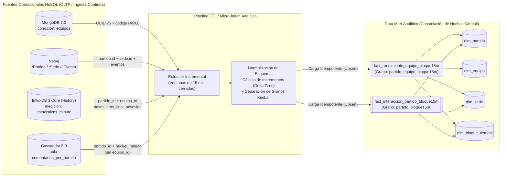

# Propuesta de Data Mart e Integración Analítica — Hito 12

**Asignatura:** Ingeniería de Datos II  
**Proyecto:** Plataforma Fixture Mundial 2030 — Grupo 5  

---

## 1. Pregunta Analítica Seleccionada (RF12, §5.7)

> **Pregunta Analítica Principal:**  
> *«¿Cómo evolucionan, por partido, selección, confederación, sede e intervalo de 15 minutos de juego, la intensidad deportiva (goles, tarjetas, cambios, posesión media, tiros al arco y pases completados) junto con el volumen de interacción social (comentarios publicados, likes y respuestas), para comparar el impacto deportivo y de audiencia entre fases y sedes del Mundial 2030?»*

### 1.1. ¿Por qué esta pregunta requiere un Data Mart en lugar de consultar las fuentes operacionales en vivo?
En la arquitectura operacional del Fixture 2030, los datos necesarios para responder esta pregunta están repartidos en **cuatro motores NoSQL con modelos y propósitos operacionales heterogéneos**:
1. **MongoDB (`equipos`, `jugadores`):** contiene el catálogo maestro de selecciones, confederación (`CONMEBOL`, `UEFA`, etc.) y origen de clasificación.
2. **Neo4j (`:Partido`, `:Sede`, `:Evento`, `:Equipo`):** contiene la topología del torneo, sede/región y los eventos deportivos discretos (`Gol`, `Tarjeta amarilla`, `Tarjeta roja`, `Cambio`) con su minuto reglamentario.
3. **InfluxDB 3 Core (`estadisticas_equipo` y `estadisticas_minuto`):** almacena la telemetría temporal de alta frecuencia (muestras cada 10 segundos) y los resúmenes consolidados minuto a minuto (`posesion_promedio`, `tiros_final`, `pases`, `muestras`).
4. **Apache Cassandra (`comentarios_por_partido`):** ingesta masiva de interacciones de usuarios, particionada por `(partido_id, bucket_minuto, grupo)` sobre 16 grupos concurrentes para evitar contención de partición en picos de comentarios.

Intentar responder esta pregunta analítica desde el camino operacional (por ejemplo, encadenando consultas a los 16 grupos por minuto en Cassandra + recorridos Cypher en Neo4j + agregaciones sobre InfluxDB + búsquedas BSON en MongoDB cada vez que un analista o directivo abre un tablero) constituiría el **antipatrón de consulta distribuida en serie sobre múltiples fuentes operacionales en tiempo real** advertido en la especificación técnica (§1, §7). Provocaría una latencia prohibitiva, alta amplificación de lectura y competencia directa por CPU, memoria y pools de conexión contra los espectadores que consultan la API en vivo.

---

## 2. Fuentes Operacionales, Procedencia y Claves de Correspondencia (RF12, RF13, RNF12)

### Tabla de Procedencia Documentada Dato por Dato (RNF12)

| Atributo / Medida en el Data Mart | Rol Dimensional | Motor de Origen | Objeto / Tabla / Colección Origen | Campo Original Real | Transformación y Mapeo Aplicado |
|:---|:---|:---|:---|:---|:---|
| `partido_id` | PK / FK Dimensión | **Neo4j** | Nodos `:Partido` | `p.id` (`F2030-001`) | Validación de formato canónico `^F2030-\d{3}$` y mapeo directo a `dim_partido`. |
| `equipo_id` | PK / FK Dimensión | **MongoDB** / **Neo4j** | Colección `equipos` / Nodos `:Equipo` | `_id` / `e.id` | Conservación del UUID v5 determinístico generado en Hito 4 (`dns:fixture2030.org/equipo/<codigo>`). |
| `equipo_codigo` | Atributo Dimensión | **MongoDB** | Colección `equipos` | `codigo` (`ARG`) | Normalización ISO 3 caracteres mayúsculas en `dim_equipo`. |
| `confederacion` | Atributo Dimensión | **MongoDB** | Colección `equipos` | `confederacion` | Mapeo directo del enumerado FIFA (`CONMEBOL`, `UEFA`, `AFC`, `CAF`, `CONCACAF`, `OFC`). |
| `sede_id`, `sede_pais`, `sede_region` | Atributos Dimensión | **Neo4j** | Nodos `:Sede` | `s.id`, `s.pais`, `s.region` | Extracción mediante la relación `(:Partido)-[:SE_JUEGA_EN]->(:Sede)` hacia `dim_sede`. |
| `fase_torneo`, `condicion_equipo` | Atributos Dimensión | **Neo4j** | Nodos `:Partido`, rel. `[:DISPUTA]` | `p.fase`, `r.condicion` | Normalización de fase y condición (`local` / `visitante`). |
| `bloque_15m_id` | PK / FK Dimensión | Derivado multi-motor | Minuto reglamentario 1-based (`e.minuto`) o inicio de minuto UTC 0-based (`time`, `bucket_minuto`) | `e.minuto` (Neo4j), `time` (InfluxDB), `bucket_minuto` (Cassandra) | Normalización previa al índice de minuto de juego (ver §2.1): para InfluxDB y Cassandra se calcula el minuto relativo 0-based $m = \lfloor(\text{ts\_utc} - t_{0,\text{partido,fuente}})/60\rfloor \in \{0..89\}$ y se asigna $B_k$ con $k = \lfloor m/15 \rfloor + 1$ ($m \in [15(k-1), 15k)$); para Neo4j (`e.minuto` $\in \{1..90\}$, 1-based) se asigna $k = \lfloor(e.\text{minuto}-1)/15\rfloor + 1$ ($e.\text{minuto} \in [15(k-1)+1, 15k]$). |
| `goles_bloque`, `tarjetas_amarillas`, `tarjetas_rojas`, `cambios_bloque` | Medidas Aditivas de Equipo | **Neo4j** | `:Evento` + `:OCURRE_EN` + `:INVOLUCRA` | `e.tipo`, `e.minuto`, `j.equipoCodigo` | Conteo condicional (`COUNT(CASE WHEN e.tipo = 'Gol' THEN 1 END)`) agrupado por `(partido_id, equipo_id, bloque_15m_id)`. |
| `posesion_promedio_pct` | Medida Semi-aditiva de Equipo | **InfluxDB 3** (base histórica) | Medición `estadisticas_minuto` (`influxdb/scripts/resumenes.py:60-77`) | `posesion_promedio`, `muestras` | Promedio ponderado de los 15 resúmenes de 1 minuto ($m \in \{15(k-1)\dots 15k-1\}$) del bloque: $\frac{\sum (\text{posesion\_promedio} \times \text{muestras})}{\sum \text{muestras}}$. |
| `pases_completados_bloque` | Medida Aditiva de Equipo | **InfluxDB 3** (base histórica) | Medición `estadisticas_minuto` | `pases` | Suma de los pases en los 15 resúmenes de 1 minuto que componen el bloque: $\sum_{m=15(k-1)}^{15k-1} \text{pases}_m$. |
| `tiros_nuevos_bloque` | Medida Aditiva de Equipo | **InfluxDB 3** (base histórica) | Medición `estadisticas_minuto` | `tiros_final` | Como cada resumen se etiqueta al **inicio** del minuto UTC $m \in \{0..89\}$ pero `tiros_final` guarda el acumulado de su **última muestra** (`m*60 + 50s`), el incremento del bloque $B_k$ ($m \in \{15(k-1)\dots 15k-1\}$) es $\Delta\text{tiros}(B_k) = \text{tiros\_final}(15k - 1) - \text{tiros\_final}(15(k-1) - 1)$, con convención inicial $\text{tiros\_final}(-1) \equiv 0$ (ver §2.1). |
| `comentarios_totales`, `likes_acumulados`, `respuestas_acumuladas` | Medidas Aditivas de Partido | **Cassandra** | Tabla `comentarios_por_partido` (`cassandra/scripts/00_esquema.cql`) | `comentario_id`, `likes`, `respuestas` | Agregación por partición `(partido_id, bucket_minuto, grupo 0..15)` para los 15 minutos del bloque ($m \in \{15(k-1)\dots 15k-1\}$): `COUNT(comentario_id)`, `SUM(likes)`, `SUM(respuestas)`. |

### 2.1. Regla de Alineación Temporal Común, Límites de Bloques y Delta Acumulado (RF13, RNF12, R3-01)

Las tres fuentes temporales no pueden cruzarse igualando directamente `e.minuto`, `time` y `bucket_minuto` porque representan el tiempo con convenciones y orígenes distintos:

1. **Definición del origen $t_{0,\text{partido,fuente}}$ y conversión a índice de minuto de juego:**
   - **Neo4j (`:Partido`, `:Evento`):** el nodo `:Partido` conserva la fecha del calendario oficial del Mundial 2030 (`2030-06-13`..`2030-06-28`), mientras que `e.minuto` expresa directamente el **minuto reglamentario de juego 1-based** ($M \in \{1, 2, \dots, 90\}$, donde el primer minuto transcurrido `[00:00, 01:00)` corresponde a `e.minuto = 1` y el último minuto `[89:00, 90:00)` a `e.minuto = 90`).
   - **InfluxDB 3 (`estadisticas_minuto` — `influxdb/scripts/generacion_prueba.py` y `resumenes.py`):** dado que la base de detalle aplica una política de retención de 7 días (`generacion_prueba.py:27`), el generador de laboratorio emite 540 muestras cada `10 s` (`5.400 s` = 90 minutos) a partir de un timestamp reciente alineado al minuto UTC, $t_{0,\text{Influx}}$, registrado en `manifest.json["inicio_s"]` (o equivalente en consulta a $\min(\text{time})$ de la serie `(partido_id, equipo_id)`). En `resumenes.py:25,42-46`, `build_summaries()` agrupa las 6 muestras de `[minute, minute + 50s]` y etiqueta la fila con el **inicio del minuto UTC** ($\text{time} = t_{0,\text{Influx}} + 60 \cdot m$). El índice de minuto de juego **0-based** se obtiene como:
     $$m = \frac{\text{utc\_seconds}(\text{time}) - t_{0,\text{Influx}}}{60} \in \{0, 1, \dots, 89\}$$
     Por consiguiente, el primer minuto (`[00:00, 01:00)`) lleva etiqueta $m = 0$ y el último minuto reglamentario (`[89:00, 90:00)`) lleva etiqueta **$m = 89$** (no existe un resumen etiquetado con $m = 90$).
   - **Cassandra (`comentarios_por_partido` — `cassandra/scripts/00_esquema.cql` y `generar_carga.py`):** en el generador sintético de Hito 9 (`generar_carga.py:33,60-61`), los 32 partidos comparten como ancla de laboratorio $t_{0,\text{Cassandra}} = \text{2030-06-13T20:00:00Z}$ (`metadata.json["inicio_utc"]`; en producción corresponde al timestamp UTC de *kick-off* real del partido) durante `duracion_segundos = 5400`. Como `bucket_minuto` trunca `creado_en` al inicio del minuto UTC (`second=0, microsecond=0`), se proyecta al mismo índice **0-based** $m$:
     $$m = \left\lfloor \frac{\text{epoch\_s}(\text{bucket\_minuto}) - t_{0,\text{Cassandra}}}{60} \right\rfloor \in \{0, 1, \dots, 89\}$$

2. **Límites inclusivos/exclusivos de cada bloque $B_k$ ($k \in \{1..6\}$) y extremos de `tiros_nuevos_bloque`:**
   - Para todo minuto 0-based $m \in \{0..89\}$, la relación con el minuto reglamentario 1-based de Neo4j es $M = m + 1$.
   - Cada bloque $B_k$ cubre el intervalo semiabierto de 15 minutos en índice 0-based $m \in [15(k-1),\; 15k)$, equivalente al conjunto entero cerrado $\{15(k-1),\; \dots,\; 15k - 1\}$ en InfluxDB/Cassandra y al intervalo cerrado $[15(k-1) + 1,\; 15k]$ en `e.minuto` de Neo4j:

| `bloque_15m_id` | Tiempo de juego `[inicio, fin)` | Índice 0-based $m$ en InfluxDB y Cassandra (`[15(k-1), 15k)`) | Minuto 1-based `e.minuto` en Neo4j (`[15(k-1)+1, 15k]`) | Fórmula exacta de `tiros_nuevos_bloque` en InfluxDB ($\text{tiros\_final}(-1) \equiv 0$) |
|:---:|:---:|:---:|:---:|:---|
| **`B1`** | `[00:00, 15:00)` | $m \in \{0, 1, \dots, 14\}$ | `1 .. 15` | $\text{tiros\_final}(m = 14) - \text{tiros\_final}(-1) = \text{tiros\_final}(14) - 0$ |
| **`B2`** | `[15:00, 30:00)` | $m \in \{15, 16, \dots, 29\}$ | `16 .. 30` | $\text{tiros\_final}(m = 29) - \text{tiros\_final}(m = 14)$ |
| **`B3`** | `[30:00, 45:00)` | $m \in \{30, 31, \dots, 44\}$ | `31 .. 45` | $\text{tiros\_final}(m = 44) - \text{tiros\_final}(m = 29)$ |
| **`B4`** | `[45:00, 60:00)` | $m \in \{45, 46, \dots, 59\}$ | `46 .. 60` | $\text{tiros\_final}(m = 59) - \text{tiros\_final}(m = 44)$ |
| **`B5`** | `[60:00, 75:00)` | $m \in \{60, 61, \dots, 74\}$ | `61 .. 75` | $\text{tiros\_final}(m = 74) - \text{tiros\_final}(m = 59)$ |
| **`B6`** | `[75:00, 90:00)` | $m \in \{75, 76, \dots, 89\}$ | `76 .. 90` | $\text{tiros\_final}(m = 89) - \text{tiros\_final}(m = 74)$ |

3. **Verificación sobre el generador existente de Hito 8 (`F2030-001`, selección `ARG`):**
   - En `influxdb/scripts/generacion_prueba.py:46-47`, para `F2030-001` y `ARG` (`match_index = 0`, `side = 0`), el contador `shots` incrementa cuando `index > 0` y `index % 37 == 0`, es decir en las muestras `index = 37` ($m = 6$), `74` ($m = 12$), `111` ($m = 18$), `148` ($m = 24$), `185` ($m = 30$), etc.
   - Durante el bloque **`B2`** ($m \in \{15..29\}$, muestras `index` $90..179$), ocurren exactamente **2 tiros** (`index = 111` en $m = 18$ e `index = 148` en $m = 24$).
   - Como `resumenes.py:44` guarda en `tiros_final` la última muestra de cada minuto, al cierre de `B1` ($m = 14$, `index = 89`) se tiene $\text{tiros\_final}(14) = 2$, y al cierre de `B2` ($m = 29$, `index = 179`) se tiene $\text{tiros\_final}(29) = 4$. Aplicando la regla de la tabla:
     $$\text{tiros\_nuevos\_bloque}(B_2) = \text{tiros\_final}(29) - \text{tiros\_final}(14) = 4 - 2 = 2$$
     lo que recupera exactamente los 2 tiros ocurridos en `[15, 30)`. (Si en cambio se restaran directamente las etiquetas UTC de los minutos $m = 30$ y $m = 15$, como $m = 30$ cubre las muestras `180..185` e incluye el tiro de `index = 185`, daría $\text{tiros\_final}(30) - \text{tiros\_final}(15) = 5 - 2 = 3$, desplazando un tiro de `B3` hacia `B2`, además de quedar indefinido en `B6` porque el minuto UTC `90` no existe).

4. **Tratamiento de entretiempo (descanso), descuento (tiempo adicionado) y fuentes sin correspondencia:**
   - **En el dataset sintético de laboratorio (Hitos 5, 8 y 9):** los generadores modelan 90 minutos continuos de juego ($m \in \{0..89\}$ en InfluxDB/Cassandra y `e.minuto` $\in \{1..90\}$ en Neo4j), sin pausa intermedia.
   - **En operación real con reloj de pared:** cada partido registra dos anclas (`t0_1T_utc` y `t0_2T_utc`). Los eventos o muestras de tiempo adicionado del primer tiempo (`45+1'..` antes de `t_fin_1T_utc`) se consolidan en `B3 (31-45+')`, y los del segundo tiempo (`90+1'..`) en `B6 (76-90+')` (o en `B7`/`B8` para prórrogas `91-105'` y `106-120+'`). Los comentarios de Cassandra emitidos durante el descanso `[t_fin_1T_utc, t0_2T_utc)` se asignan a un bloque técnico `B_ET` (*Entretiempo*) en `fact_interaccion_partido_bloque15m` para no distorsionar `B3` ni `B4`.
   - **Fuente sin correspondencia o ventana incompleta:** si para una clave `(partido_id, bloque_15m_id)` una fuente aún no registra datos o posee menos de 15 minutos cerrados (`minutos_cubiertos < 15`), no se imputan ceros artificiales: la tabla de hechos registra `estado_extraccion = 'INCOMPLETO_FUENTE_FALTANTE'`, y la vista `vw_partido_audiencia_rendimiento_15m` utiliza `LEFT JOIN` preservando `NULL` en las métricas de la fuente ausente hasta su consolidación.

---

## 3. Grano, Desacople de Medidas y Modelo Constelación de Kimball (RF12, H12-04)

### 3.1. Detección y Resolución de la Incompatibilidad de Granos
Una inspección técnica rigurosa de las fuentes revela una discrepancia fundamental de grano:
- **Las estadísticas deportivas de InfluxDB y los eventos de Neo4j tienen grano de equipo:** tanto `estadisticas_minuto` (con tags `partido_id` y `equipo_id`) como los eventos con relación `[:INVOLUCRA]->(:Jugador)` se atribuyen unívocamente a una selección participante.
- **Los comentarios de Cassandra tienen grano de partido:** la tabla `comentarios_por_partido` está particionada por `((partido_id, bucket_minuto, grupo))` y almacena comentarios de hinchas que opinan sobre el encuentro general. **No existe un campo `equipo_id` en Cassandra.**

> [!WARNING] Riesgo de Doble Conteo si se fuerza un Grano Incompatible
> Si se intentara almacenar las medidas sociales (`comentarios_totales`, `likes`) dentro de una única tabla de hechos con grano `(partido_id, equipo_id, bloque_15m_id)`, **cada comentario se duplicaría obligatoriamente** en la fila del equipo local y en la fila del equipo visitante. Al ejecutar consultas analíticas agregadas (por ejemplo, *«total de comentarios en partidos de CONMEBOL»* o *«comentarios totales de la fase de grupos»*), la suma arrojaría exactamente el **doble ($2\times$) de la audiencia real**, violando los principios de diseño dimensional de Kimball.

### 3.2. Modelo Dimensional Propuesto: Esquema Constelación (*Fact Constellation*)
Para preservar la aditividad estricta de todas las medidas sin forzar datos artificiales ni inventar atribuciones no presentes en las fuentes operacionales, el Data Mart implementa dos tablas de hechos que comparten dimensiones conformadas:

1. **`fact_rendimiento_equipo_bloque15m` (Grano: `partido_id, equipo_id, bloque_15m_id`):**
   - Aloja las medidas deportivas propias de cada selección en cada cuarto de hora.
   - Cada partido reglamentario genera $2 \times 6 = 12$ filas.
   - En los 32 partidos del laboratorio genera exactamente **384 filas**; en los 127 partidos proyectados del Mundial 2030 genera **1.524 filas**.
2. **`fact_interaccion_partido_bloque15m` (Grano: `partido_id, bloque_15m_id`):**
   - Aloja las medidas de audiencia e interacción social del encuentro en ese cuarto de hora.
   - Cada partido reglamentario genera 6 filas (1 por bloque temporal).
   - En los 32 partidos genera **192 filas**; en los 127 partidos proyectados genera **762 filas**.
3. **Vista Unificada de Consumo Analítico (`vw_partido_audiencia_rendimiento_15m`):**
   - Cruza ambas tablas mediante `JOIN` por `(partido_id, bloque_15m_id)` para tableros que requieren correlacionar goles/tarjetas con picos de comentarios, conservando la trazabilidad de que los comentarios son una medida a nivel partido y no atribuible unívocamente a un equipo sin un proceso adicional de NLP/menciones.

### 3.3. Ventaja del Grano y Estimación de Rendimiento (§5.7, H12-08)
- **Reducción masiva de volumen:** Millones de muestras temporales de 10 s y millones de comentarios distribuidos en 16 particiones por minuto se consolidan en menos de **2.300 registros totales por torneo completo**.
- **Objetivo de diseño analítico estimado:** Esta estructura compacta permite responder agregaciones multi-partido, cruces por confederación, sede o etapa en **tiempos de orden de milisegundos en motores OLAP tabulares o columnares**.  
  *Nota de honestidad experimental (RNF14, §5.7):* Esta cifra representa un objetivo de diseño técnico derivado del dimensionamiento de filas en memoria; el Data Mart constituye una propuesta arquitectónica y no fue implementado ni medido experimentalmente en este laboratorio.

---

## 4. Flujo ETL, Frecuencia, Retraso Aceptable y Tolerancia a Fallas (RF13, §5.7)

| Dimensión Operativa | Especificación Técnica | Justificación Arquitectónica |
|:---|:---|:---|
| **Estrategia de extracción** | **Micro-batch por ventana cerrada de 15 minutos:** - Las dimensiones maestras (`dim_equipo`, `dim_sede`, `dim_partido`) se sincronizan al inicio de cada jornada en batch. - Las métricas de hechos se extraen por bloques temporales cerrados desde `estadisticas_minuto` (InfluxDB), eventos de Neo4j y `comentarios_por_partido` (Cassandra). | Minimiza el consumo de recursos operacionales al evitar la extracción streaming registro por registro en motores diseñados para batch/particiones. |
| **Frecuencia de ejecución** | **Cada 5 minutos en partidos en vivo** (actualización provisional del bloque activo) y **consolidación definitiva a los 15 minutos post-partido** (`estado = 'Finalizado'`). | Provee información analítica oportuna para análisis táctico y de prensa sin saturar los motores operacionales durante el juego. |
| **Retraso aceptable (SLA de frescura)** | **De 1 a 5 minutos durante el partido; hasta 15 minutos post-partido.** | Las preguntas analíticas estratégicas (comparación de confederaciones, sedes o cuartos de hora) no requieren latencia sub-segundo; priorizan consistencia y completitud sobre inmediatez. |
| **Tratamiento de datos tardíos (*Late-arriving data*)** | Siguiendo el principio de Hito 8 (`influxdb/scripts/resumenes.py`), un minuto en InfluxDB solo se consolida cuando están presentes sus 6 muestras de 10 s. El proceso ETL evalúa una **ventana deslizante de re-lectura de 30 minutos** (bloque actual y bloque previo) para capturar eventos de arbitraje o comentarios ingresados con retraso de red. | Evita truncar métricas por asincronía de relojes o retrasos de ingesta sin reescribir todo el torneo. |
| **Estrategia ante duplicados e idempotencia** | Inserción mediante **`UPSERT` (`INSERT ... ON CONFLICT (partido_id, equipo_id, bloque_15m_id) DO UPDATE`)** reemplazando las medidas del bloque con el recálculo determinístico de la ventana completa. | Si el proceso ETL se ejecuta múltiples veces ante reintentos de red, el estado final del Data Mart es estrictamente idéntico. |
| **Tratamiento ante fallas parciales o caídas de fuente** | Si Cassandra sufre un timeout durante la extracción pero InfluxDB y Neo4j responden, se persiste el registro en `fact_rendimiento_equipo_bloque15m`, y en `fact_interaccion_partido_bloque15m` se registra un flag de calidad `estado_extraccion = 'PARCIAL_REINTENTO_PENDIENTE'`, programando un reintento en el siguiente ciclo. | Evita publicar ceros artificiales como si no hubiera comentarios y asegura completitud eventual. |
| **Auditoría de integridad y validación de agregados** | Al finalizar cada partido se valida automáticamente: 1) $\sum \text{goles\_bloque} == \text{COUNT}(:Evento \{\text{tipo}: \text{'Gol'}\})$ en Neo4j. 2) $\sum \text{pases\_completados\_bloque} == \sum \text{pases}$ en `estadisticas_minuto` de InfluxDB. 3) $\sum \text{comentarios\_bloque} == \text{COUNT}(*)$ en Cassandra para ese partido. | Asegura que la capa analítica sea un reflejo matemático exacto de las fuentes operacionales. |

---

## 5. Comparación Crítica: Consulta Operacional Distribuida vs. Consulta al Data Mart (§5.7)

| Criterio Evaluado | Consulta Distribuida a las 4 Fuentes Operacionales en Vivo | Consulta a la Proyección Pre-Agregada del Data Mart |
|:---|:---|:---|
| **Cantidad de conexiones y protocolos** | 4 protocolos distintos (Bolt, MongoDB Wire Protocol, InfluxDB HTTP/Flight, CQL) con al menos 19 consultas de red por minuto analizado. | **1 sola conexión SQL/OLAP** sobre el Data Mart dimensional. |
| **Complejidad de transformación en lectura** | La aplicación cliente debe normalizar en memoria UUIDs v5, códigos ISO, calcular promedios ponderados y sumar 16 particiones por minuto de Cassandra. | Las claves ya están unificadas, las dimensiones conformadas y los totales pre-agregados en el grano de 15 minutos. |
| **Riesgo de degradación operacional** | **Crítico:** analistas ejecutando consultas pesadas saturan memoria y pools de conexión compartidos con los usuarios de la app en vivo. | **Aislamiento total:** la carga analítica está físicamente desacoplada del camino crítico operacional. |
| **Frescura del dato** | En tiempo real estricto (0–2 segundos). | Retraso controlado (1–5 minutos durante partido, 15 minutos consolidado). |
| **Caso de uso idóneo** | Visualización operativa en vivo del partido en curso (`GET /partidos/:id`, feed de eventos y comentarios recientes). | Análisis táctico post-partido, tableros de audiencia por sede/confederación, informes para prensa y auditoría histórica del torneo. |
