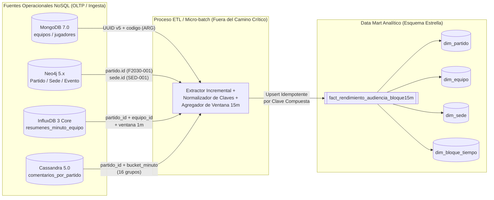

# Propuesta de Data Mart e Integración Analítica — Hito 12

**Asignatura:** Ingeniería de Datos II  
**Proyecto:** Plataforma Fixture Mundial 2030 — Grupo 5  

---

## 1. Pregunta Analítica Seleccionada (RF12, §5.7)

> **Pregunta Analítica Principal:**  
> *«¿Cómo evolucionan, por partido, selección, confederación, sede e intervalo de 15 minutos de juego, la intensidad deportiva (goles, tarjetas, cambios, posesión media, tiros al arco y pases completados) junto con el volumen de interacción social (comentarios publicados, likes y respuestas), para comparar el impacto deportivo y de audiencia entre fases y sedes del Mundial 2030?»*

### 1.1. ¿Por qué esta pregunta requiere un Data Mart en lugar de consultar las fuentes operacionales en vivo?
En la arquitectura operacional del Fixture 2030, los datos necesarios para responder esta pregunta están repartidos en **cuatro motores NoSQL con modelos heterogéneos**:
1. **MongoDB (`equipos`, `jugadores`):** contiene la confederación (`CONMEBOL`, `UEFA`, etc.) y el origen de clasificación de cada selección.
2. **Neo4j (`:Partido`, `:Sede`, `:Evento`, `:Equipo`):** contiene la fase del torneo, la sede/región y los eventos deportivos (`Gol`, `Tarjeta amarilla`, `Cambio`) con su minuto.
3. **InfluxDB 3 Core (`estadisticas_equipo`, `resumenes_minuto_equipo`):** contiene las series temporales de `posesion_pct`, `tiros_acumulados` y `pases_intervalo` capturadas cada 10 segundos y resumidas por minuto.
4. **Apache Cassandra (`comentarios_por_partido`):** almacena los comentarios particionados en 16 *buckets* por `(partido_id, bucket_minuto, grupo)`.

Intentar responder esta pregunta analítica desde el camino operacional (por ejemplo, encadenando en cada request HTTP de un analista o dashboard consultas a los 16 grupos por minuto de Cassandra + recorridos Cypher en Neo4j + SQL sobre InfluxDB + lecturas BSON en MongoDB) constituiría el **antipatrón de consulta distribuida en serie sobre seis fuentes en tiempo real** advertido en la especificación (§1, §7). Provocaría alta latencia, amplificación de lectura y competencia directa con los recursos que atienden a los espectadores en vivo.

---

## 2. Fuentes Operacionales, Procedencia y Claves de Correspondencia (RF12, RNF12)

### Tabla de Procedencia Documentada Dato por Dato (RNF12)

| Atributo / Medida en el Data Mart | Rol en Estrella | Motor de Origen | Colección / Tabla / Etiqueta Origen | Campo Original | Transformación Aplicada |
|:---|:---|:---|:---|:---|:---|
| `partido_id` | PK / FK Dimensión | **Neo4j** | `:Partido` | `p.id` (`F2030-001`) | Validación de patrón `^F2030-\d{3}$` y mapeo directo. |
| `equipo_id` | PK / FK Dimensión | **MongoDB** / **Neo4j** | `equipos` / `:Equipo` | `_id` / `e.id` (UUID v5) | Conservación del UUID v5 determinístico (`equipo:<codigo>`). |
| `equipo_codigo` | Atributo Dimensión | **MongoDB** | `equipos` | `codigo` (`ARG`) | Normalización ISO 3 letras mayúsculas. |
| `confederacion` | Atributo Dimensión | **MongoDB** | `equipos` | `confederacion` | Mapeo directo del enum (`CONMEBOL`, `UEFA`, `AFC`, `CAF`, `CONCACAF`, `OFC`). |
| `sede_id`, `sede_region`, `sede_pais` | Atributos Dimensión | **Neo4j** | `:Sede` | `s.id`, `s.region`, `s.pais` | Extracción por relación `(:Partido)-[:SE_JUEGA_EN]->(:Sede)`. |
| `fase_torneo`, `condicion_equipo` | Atributos Dimensión | **Neo4j** | `:Partido`, `[:DISPUTA]` | `p.fase`, `r.condicion` | Normalización de `local` / `visitante` y etapa del torneo. |
| `bloque_15m_id` | PK / FK Dimensión | Derivado (`Neo4j` / `InfluxDB` / `Cassandra`) | Minuto o timestamp UTC | `e.minuto`, `time`, `bucket_minuto` | Discretización en 6 bloques reglamentarios: `B1 (0-15')`, `B2 (16-30')`, `B3 (31-45+')`, `B4 (46-60')`, `B5 (61-75')`, `B6 (76-90+')`. |
| `goles_bloque`, `tarjetas_amarillas_bloque`, `tarjetas_rojas_bloque`, `cambios_bloque` | Medidas Aditivas | **Neo4j** | `:Evento` + `:OCURRE_EN` + `:INVOLUCRA` | `e.tipo`, `e.minuto`, `j.equipoCodigo` | Conteo condicional (`COUNT CASE WHEN e.tipo = ...`) agrupado por `(partido_id, equipo_codigo, bloque_15m_id)`. |
| `posesion_promedio_pct` | Medida Semi-aditiva | **InfluxDB 3** | `resumenes_minuto_equipo` | `posesion_promedio` | Promedio ponderado (`SUM(posesion_promedio * muestras) / SUM(muestras)`) de los minutos cerrados del bloque. |
| `pases_completados_bloque` | Medida Aditiva | **InfluxDB 3** | `resumenes_minuto_equipo` | `pases_minuto` | Suma (`SUM(pases_minuto)`) de los 15 resúmenes de un minuto del bloque. |
| `tiros_nuevos_bloque` | Medida Aditiva | **InfluxDB 3** | `resumenes_minuto_equipo` | `tiros_acumulados_max` | Diferencia monotónica $\max(\text{tiros\_bloque\_actual}) - \max(\text{tiros\_bloque\_anterior})$ controlando no-negatividad. |
| `comentarios_totales_partido`, `likes_acumulados`, `respuestas_acumuladas` | Medidas Aditivas | **Cassandra** | `comentarios_por_partido` | `comentario_id`, `likes`, `respuestas` | Lectura por partición `(partido_id, bucket_minuto, grupo 0..15)` de los minutos del bloque y agregación `COUNT(*)`, `SUM(likes)`, `SUM(respuestas)`. |

---

## 3. Grano y Modelo Dimensional de la Vista Analítica (§5.7)

- **Nivel de detalle (Grano):** **Una fila por `(partido_id, equipo_id, bloque_15m_id)`**.
  - En un partido reglamentario de 90 minutos (6 bloques de 15 minutos) con 2 selecciones participantes, cada partido genera exactamente **$2 \times 6 = 12$ filas** en la tabla de hechos `fact_rendimiento_audiencia_bloque15m`.
  - Para los 32 partidos del laboratorio se generan **$32 \times 12 = 384$ filas**; para los 127 partidos proyectados del Mundial 2030 completo se generarían **$127 \times 12 = 1.524$ filas** (o $1.778$ filas incluyendo eventuales bloques `B7` y `B8` de prórroga).
- **Ventaja del grano elegido:** Reduce millones de puntos temporales de InfluxDB y millones de comentarios de Cassandra a una tabla de hechos sumamente compacta ($< 2.000$ filas por torneo), capaz de responder cualquier cruce por confederación, sede, fase, selección o tramo de partido en $< 5\text{ ms}$ sin tocar las bases operacionales.

---

## 4. Flujo ETL / Actualización, Frecuencia, Retraso y Tolerancia a Fallas (RF13, §5.7)

| Aspecto del Pipeline Analítico | Definición Técnica y Justificación |
|:---|:---|
| **Estrategia de extracción** | **Híbrida (Dimensiones en Batch + Hechos en Micro-batch por ventana temporal):** - Las dimensiones (`dim_equipo`, `dim_sede`, `dim_partido`) se sincronizan al inicio de cada jornada o ante cambios programados. - Las medidas de `fact_rendimiento_audiencia_bloque15m` se extraen por ventana cerrada de minutos desde `resumenes_minuto_equipo` (InfluxDB), `:Evento` (Neo4j) y `comentarios_por_partido` (Cassandra). |
| **Frecuencia de actualización** | **Cada 5 minutos durante partidos en curso** (actualización parcial del bloque de 15m activo) y **consolidación definitiva 15 minutos después de finalizar el partido** (`estado = Finalizado`). |
| **Retraso aceptable (SLA de frescura)** | **De 1 a 5 minutos** para tableros de seguimiento analítico durante la jornada, y **hasta 15 minutos post-partido** para reportes oficiales de prensa y análisis táctico. Las decisiones analíticas (comparar sedes, fases o evolución por cuartos de hora) no requieren latencia sub-segundo. |
| **Política ante datos tardíos (Late-arriving data)** | Siguiendo la regla implementada en el Hito 8 (`influxdb/scripts/resumenes.py`), un minuto de InfluxDB solo se resume cuando están presentes las 6 lecturas de 10 segundos. El job ETL re-procesa una **ventana deslizante de los últimos 30 minutos** (el bloque actual y el bloque inmediatamente anterior), incorporando eventos o comentarios con timestamp tardío. |
| **Política ante duplicados e idempotencia** | La carga en `fact_rendimiento_audiencia_bloque15m` utiliza **`UPSERT` (`INSERT ... ON CONFLICT (partido_id, equipo_id, bloque_15m_id) DO UPDATE`)** reemplazando las medidas del bloque con el recálculo determinístico de la ventana completa, en lugar de sumar incrementalmente a ciegas. Si el job se ejecuta tres veces sobre el mismo bloque, el resultado final es idéntico. |
| **Política ante datos faltantes o fallas parciales** | Si una de las fuentes (por ejemplo, Cassandra) sufre un timeout durante el micro-batch, la fila del bloque conserva un flag de calidad `estado_completitud = 'PARCIAL_SIN_COMENTARIOS'` y registra el `watermark` pendiente para reintentar en el siguiente ciclo, evitando publicar un `0` falso como si no hubieran existido comentarios. |
| **Estrategia de validación de conteos y agregados** | Al cierre de cada partido se ejecuta una auditoría cruzada automática: 1) $\sum \text{goles\_bloque} == \text{COUNT}(:Evento \{\text{tipo}: \text{'Gol'}\})$ en Neo4j. 2) $\sum \text{pases\_completados\_bloque} == \sum \text{pases\_minuto}$ en InfluxDB. 3) Cantidad de equipos por partido en la tabla de hechos $== 2$. |

---

## 5. Comparación: Consultar Fuentes Operacionales vs. Consultar la Proyección Analítica (§5.7)

| Criterio | Consulta Directa a las 4 Fuentes Operacionales en Serie/Paralelo | Consulta a la Vista Analítica Pre-Integrada (Data Mart) |
|:---|:---|:---|
| **Cantidad de motores y conexiones por consulta** | 4 motores distintos (MongoDB + Neo4j + InfluxDB + Cassandra) y al menos $1 + 1 + 1 + 16 = 19$ operaciones de red por minuto consultado. | **1 sola consulta** sobre la estructura analítica (`fact_rendimiento_audiencia_bloque15m`). |
| **Complejidad de unión en tiempo de lectura** | La aplicación debe cruzar en memoria UUIDs de MongoDB, códigos de 3 letras de Neo4j, tags de InfluxDB y particiones de Cassandra. | Los identificadores ya están normalizados y pre-unidos mediante claves sustitutas/naturales validadas. |
| **Impacto sobre el tráfico en vivo del Mundial** | **Alto riesgo:** consultas analíticas pesadas compiten por CPU, memoria y pools de conexiones con los espectadores que consultan el partido o publican comentarios. | **Aislamiento total:** el consumo analítico ocurre fuera del camino crítico operacional. |
| **Frescura del dato** | Tiempo real (0–2 segundos). | Retraso controlado y documentado (1–5 minutos en vivo; 15 minutos consolidado). |
| **Caso de uso apropiado** | Pantalla operativa del partido en curso (`GET /partidos/:id`, feed de últimos comentarios). | Preguntas analíticas multi-partido, comparativas por confederación/sede, reportes históricos y BI. |
